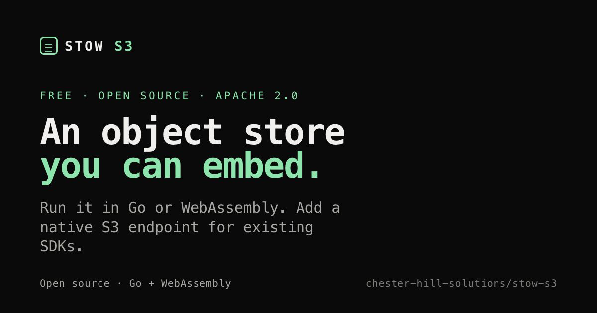

# Stow

<!-- repo-only:start -->
[](https://www.npmjs.com/package/@chester-hill-solutions/stow-s3)
[](https://github.com/chester-hill-solutions/stow-s3/releases/latest)
[](https://github.com/chester-hill-solutions/stow-s3/actions/workflows/ci.yml)
[](LICENSE)

<p align="center">
  <a href="https://stow.chesterhillsolutions.ca/"></a>
</p>
<!-- repo-only:end -->

Stow stores objects, files and checkpoints for applications, agents and tests.
Use an S3 endpoint, a native file workspace, or an embedded runtime.
Browser APIs add local editing history and remote sync.

Your application runs the code and controls network access. Stow manages storage.

```sh
npm install @chester-hill-solutions/stow-s3@0.3.7
```

[Stow v0.4.0](docs/releases/v0.4.0.md) adds scoped MCP workspace file resources,
managed file saves and immutable checkpoint reads. Native binaries are available
for Linux and macOS, x64 and ARM64, from
[GitHub Releases](https://github.com/chester-hill-solutions/stow-s3/releases/tag/v0.4.0).
The npm install command above selects the published 0.3.7 package; npm 0.4.0
and PyPI publication remain disabled.

The TypeScript package includes its native binary for Linux and macOS on x64 and ARM64.
Node.js 20 or newer is required. Python uses a source checkout.

[Documentation](https://stow.chesterhillsolutions.ca/docs/) ·
[Getting started](docs/guides/getting-started.md) ·
[v0.4.0 release notes](docs/releases/v0.4.0.md) ·
[Examples](examples/stow-recipes/README.md)

<!-- repo-only:start -->
<details>
<summary><strong>Jump to a workflow</strong></summary>

- [Choose a storage surface](#storage-surfaces)
- [Prepare and checkpoint a workspace](#a-workspace-end-to-end)
- [Start a disposable S3 session](#quick-start-a-scoped-session)
- [Run the native server](#quick-start-cli-server)
- [Embed Go or WebAssembly](#embedded-go-runtime)
- [Work offline with a read-through cache](#run-through-mode-the-offline-cache)
- [Installation options](#install)
- [Diagnose an installation](#diagnostics-stow-doctor)
- [Contribute](CONTRIBUTING.md)

</details>
<!-- repo-only:end -->

## Storage surfaces

- **S3 service:** use an S3 SDK with memory or filesystem storage.
  TypeScript and Python sessions start a private server and stop it on close.
  [Run-through mode](docs/guides/run-through.md) adds a remote cache for offline reads.
  Set `STOW_BUCKET` to restrict upstream reads to one bucket.
  Prewarming keys does not restrict later online reads.
- **Workspace:** prepare a directory, capture checkpoints, compare changes, and transfer work.
  The embedded API and `workspace serve` share one runtime.
  The S3 filesystem backend uses a separate object-record format.
  Native Go APIs support [guarded saves and recovery receipts](docs/guides/portable-workspace-usage.md#managed-saves-in-native-storage).
  MCP callers can use the [fixed-bucket object tools](docs/guides/portable-workspace-usage.md#native-object-mcp).
  Native v0.4.0 adds [scoped file resources](docs/guides/workspace-resources.md),
  [managed file saves](docs/guides/workspace-file-saves.md) and
  [selected checkpoint reads](docs/guides/checkpoint-resources.md).
- **Browser storage:** keep objects and editing history in IndexedDB.
  [File history](docs/guides/browser-file-history.md) stores whole-file stages.
  [Project storage](docs/guides/browser-project-storage.md) shares content between multi-file revisions.
  [Workers](docs/guides/browser-worker-runtime.md) support binary transport and bounded streams.
  Your application supplies the sync transport.

The [MCP bucket browser](extensions/stow/README.md) adds read-only previews and object references.

Stow can keep upstream credentials separate from local credentials.
It does not restrict other host processes or their network access.
Storage quotas do not limit files written directly by those processes.

<!-- repo-only:start -->
The [storage plan](docs/development/storage-foundation-plan.md) tracks unfinished work.
The [OpenCode example](examples/opencode/README.md) requires a confirmed checkpoint before each prompt.
Named host/model interruption and second-host acceptance remain separate from
the native Linux/macOS release checks recorded in the release notes.
MCP tool access alone does not ensure a checkpoint after every turn.

Live collaboration work belongs to [GangCode](docs/design/gangcode-stow-boundary.md).
The retired ownership-based multiplayer experiment remains in
[Git history](docs/history/experiments/multiplayer-prototype.md).
<!-- repo-only:end -->
## Checkpoints and editing history

Native workspace deltas compare checkpoints in one workspace and verify the
named base before applying changes. They do not merge independently edited
workspaces. Browser file and project APIs separately retain revisions you can
undo and redo. Applications own document semantics and conflict resolution.

## What Stow provides

- A workspace for an agent: declared inputs, immutable checkpoints, diff,
  restore, portable handoff, and adoption on another machine.
- An S3 HTTP server for local development and tests.
- A scoped session API for TypeScript and Python: one call starts a private
  server, hands back a ready S3 client, and cleans everything up on close.
- A run-through cache: local data with an upstream behind it, usable offline.
- A Go runtime for in-process, memory-backed storage.
- A WebAssembly runtime for Node.js and browser integrations.
- [Browser file history](docs/guides/browser-file-history.md) with persisted undo/redo stages,
  read-through access, and explicit conditional sync to S3-compatible storage.
- Filesystem persistence for data that must survive a process restart.
- SigV4 authentication for the S3 endpoint.
- `stow-s3 doctor`, a diagnostic that reports both the client and server sides of an
  installation.

Applications use Stow to create buckets and upload or download files through the
S3 APIs they already use. A **bucket** is a named container. An **object** is a
file stored in a bucket, together with metadata such as its content type, size,
and ETag.

Stow implements the common S3 operations needed by application and test workloads:

- create, inspect, list, and delete buckets;
- put, get, head, copy, and delete objects;
- list objects with prefixes and pagination;
- range reads;
- conditional writes and reads;
- MD5, CRC32, CRC32C, CRC64NVME, SHA-1, and SHA-256 checksums;
- multipart uploads;
- presigned requests.

CRC64NVME applies to single objects. Multipart initiation with that algorithm is
refused. The [S3 compatibility contract](docs/contracts/compat-contract.md) records the
full detail.

Stow implements a subset of Amazon S3. Versioning, ACLs, bucket policies, lifecycle rules, replication, notifications, tagging, object lock, S3 Select, and KMS-backed encryption are not implemented.

Stow is a static binary with no runtime dependency. Use another S3 implementation
if your workload needs versioning, bucket policies, or another unsupported operation.

## When to use it

Use Stow for:

- agent working directories, checkpoints and transfer;
- local development and tests that need an S3 API;
- disposable object storage in CI;
- cached reads when an upstream is offline;
- embedded Go, Node.js or browser storage.

## A workspace, end to end

Declare the inputs in a manifest. The manifest states where the workspace lives,
which files to seed it with, and which team's partition of the registry it
belongs to. The root's parent directory must already exist:

```json
{
  "version": 1,
  "root": "/srv/agents/task-42",
  "team": "platform",
  "inputs": [
    { "source": "/srv/inputs/spec.md", "destination": "spec.md" },
    { "source": "/srv/inputs/fixtures", "destination": "fixtures" }
  ]
}
```

Prepare the workspace. The result includes its ID, seeded totals and root directory:

```sh
stow-s3 workspace prepare --manifest task.json
```

```json
{
  "workspace_id": "ws_843fbd0cdf9b744b",
  "root": "/srv/agents/task-42",
  "seeded_objects": 2,
  "seeded_bytes": 16,
  "team": "platform"
}
```

Run the agent in `root`. Pause writers before capturing a checkpoint.
Checkpoints are immutable and content-addressed.
Use `--team platform` on later commands to select the same registry partition:

```sh
stow-s3 workspace checkpoint --id ws_843fbd0cdf9b744b --team platform
```

```json
{
  "checkpoint_id": "cp_a4424a293103532626d4a507",
  "workspace_id": "ws_843fbd0cdf9b744b",
  "files": 2,
  "bytes": 16
}
```

Compare two checkpoints from the same workspace:

```sh
stow-s3 workspace checkpoint --id ws_843fbd0cdf9b744b \
  --parent cp_a4424a293103532626d4a507 --team platform
stow-s3 workspace diff --from cp_a4424a293103532626d4a507 \
  --to cp_77f5079ad25db3e0a66ae6cb --team platform
```

```json
{
  "changes": [{ "path": "report.md", "kind": "added" }]
}
```

Create a handoff with `--archive` to transfer the work.
The handoff records the archive path relative to the document. Move both files together.
See the [workspace guide](docs/guides/portable-workspace-usage.md) for supported destination hosts.

```sh
stow-s3 workspace handoff \
  --id ws_843fbd0cdf9b744b \
  --checkpoint-id cp_77f5079ad25db3e0a66ae6cb \
  --team platform \
  --archive /tmp/task-42.tar.gz \
  --output /tmp/task-42.handoff.json
```

`--output` writes the document without printing it.
Without `--archive`, the reference is local (version 1). With it, the reference is portable (version 2).

On the receiving machine, adopt the handoff. Stow verifies the archive and digest before writing files:

```sh
stow-s3 workspace adopt --handoff /tmp/task-42.handoff.json --root /srv/agents/task-42
```

```json
{
  "workspace_id": "ws_460a0b6f67fb107b",
  "root": "/srv/agents/task-42",
  "checkpoint_id": "cp_77f5079ad25db3e0a66ae6cb",
  "seeded_objects": 3,
  "seeded_bytes": 32
}
```

`adopt` creates a new workspace ID. `resume --handoff` opens the original workspace named in the document.
`resume` rejects a handoff combined with `--registry-dir`:

```console
$ stow-s3 workspace resume --handoff task-42.handoff.json --registry-dir /elsewhere
workspace resume accepts --handoff or --id/--registry-dir/--team, not both
```

Use `delta` to transfer changes between two checkpoints:

```sh
stow-s3 workspace delta --from cp_a4424a293103532626d4a507 \
  --to cp_77f5079ad25db3e0a66ae6cb --team platform --output change.stowdelta
```

```json
{
  "version": 1,
  "base_id": "cp_a4424a293103532626d4a507",
  "target_id": "cp_77f5079ad25db3e0a66ae6cb",
  "files": 1,
  "bytes": 16
}
```

`apply` checks preconditions and payload digests before writing.
To verify the whole document, pass the digest reported by `delta`:

```sh
stow-s3 workspace apply --delta change.stowdelta --base cp_a4424a293103532626d4a507 \
  --team platform --expect-sha256 58338f9f00c64e4d2...
```

```console
$ stow-s3 workspace apply --delta renamed.stowdelta --base cp_a4424a... --team platform \
    --expect-sha256 58338f9f00c64e4d2...
delta refused: delta document does not match the digest the sender published:
the document hashes to f7388c05885e824e8..., the sender published 58338f9f00c64e4d2...
```

This check is optional. Receive the digest through a trusted channel;
an altered document and its replacement digest can still agree.

See [the task manifest and workspace lifecycle guide](docs/contracts/task-manifest.md)
for the schema, archive safety rules, and limitations. A workspace is filesystem
isolation for task editing, not an OS sandbox; direct filesystem writes by the
agent are not hard-limited by Stow's object API quotas. Task manifests can stage
explicit refs from local Git repositories; dirty files, older history,
submodules, and Git LFS payloads are not included.

### Finding a workspace again

`workspace list` shows registered workspaces, ordered by idle time:

```sh
stow-s3 workspace list --team platform
```

```json
{
  "version": 1,
  "registry_dir": "/srv/agents/registry/teams/platform",
  "team": "platform",
  "count": 1,
  "results": [
    {
      "id": "ws_a8b5f66d008f6d1f",
      "dir": "/srv/agents/task-42",
      "bucket": "stow-workspace-195241444f2339e0",
      "created": "2026-09-26T09:14:02Z",
      "last_used": "2026-09-27T09:14:02Z",
      "idle_seconds": 86400,
      "age_seconds": 172800,
      "ttl_seconds": 0,
      "expires_in_seconds": 0,
      "has_ttl": false,
      "owned": true,
      "readable": true
    }
  ]
}
```

Use the returned `id` with other workspace commands.
`readable: false` means the workspace directory is missing; its registry entry still exists.
`registry_dir` includes the selected team partition.
Check `has_ttl` before interpreting `expires_in_seconds`: zero can also mean no TTL.
Listing does not create a registry or open a workspace.

`workspace collect` removes expired workspaces that are eligible and unused.
It preserves adopted directories and workspaces without a TTL.
Use `prune` to remove registry entries for directories that are already missing:

```sh
stow-s3 workspace prune --include-adopted
```

`prune` removes registry entries and checkpoint references, not workspace data.
It keeps entries for existing directories and reports them as `present`.
Adopted entries remain unless you pass `--include-adopted`.
Removal coordinates with active storage operations.

## Install

Install the TypeScript client and its native binary from public npmjs:

```bash
npm install @chester-hill-solutions/stow-s3@0.3.7
```

The package includes a platform carrier for Linux or macOS on x64 or ARM64.
No Go installation or `STOW_BIN` override is needed. Use WSL on Windows.
Remove any old scope override to `npm.pkg.github.com`; these packages use npmjs.

Standalone v0.4.0 native binaries are available from
[GitHub Releases](https://github.com/chester-hill-solutions/stow-s3/releases/tag/v0.4.0).
Verify the archive against `SHA256SUMS.txt`, extract it and put `stow-s3` on your PATH.
Run `stow-s3 --version` to check the installed version.
See the [release notes](docs/releases/v0.4.0.md) for upgrade compatibility.

**The Python client is not yet published to PyPI.** Use a source checkout for Python.
The [npm publication record](docs/development/npm-publishing.md#published-037) describes the
verified release. Future automated registry publication remains disabled.

The Go module is published:

```bash
go get github.com/chester-hill-solutions/stow-s3/pkg/stow
```

For Python or local TypeScript development, use a source checkout:

```bash
git clone https://github.com/chester-hill-solutions/stow-s3
cd stow-s3
make build                        # bin/stow-s3 for your platform
export STOW_BIN="$PWD/bin/stow-s3"

# TypeScript development
cd packages/stow-s3 && npm install && npm run build && cd ../..

# Python client
pip install -e "packages/stow-s3-py[boto3]"
```

`STOW_BIN` selects the source-built binary. The npm package carries its own binary.
`stow-s3 doctor` reports which side is broken if the binary cannot be found or run.

## Quick start: a scoped session

A session starts a private server on an ephemeral port and waits for readiness.
Closing the session stops the server and removes its data directory.

TypeScript:

```bash
npm install @chester-hill-solutions/stow-s3@0.3.7
```

```ts
import { GetObjectCommand, PutObjectCommand } from "@aws-sdk/client-s3";
import { withStow } from "@chester-hill-solutions/stow-s3";

const body = await withStow(async (session) => {
  await session.s3.send(new PutObjectCommand({
    Bucket: session.bucket,
    Key: "input.json",
    Body: '{"task":"summarize"}',
  }));

  const fetched = await session.s3.send(new GetObjectCommand({
    Bucket: session.bucket,
    Key: "input.json",
  }));
  return fetched.Body?.transformToString();
});
```

`withStow` closes the session even if the callback throws, and reports both
errors if the close also fails. Use `openStow` when you need the session to
outlive a single callback.

Python (not yet on PyPI — see [Install](#install)):

```bash
make build && export STOW_BIN="$PWD/bin/stow-s3"
pip install -e "packages/stow-s3-py[boto3]"
```

```python
from stow_s3 import with_session

with with_session() as session:
    s3 = session.s3_client()
    bucket = session.new_bucket_name()
    s3.create_bucket(Bucket=bucket)
    s3.put_object(Bucket=bucket, Key="input.json", Body=b'{"task":"summarize"}')
    body = s3.get_object(Bucket=bucket, Key="input.json")["Body"].read()
```

TypeScript creates `session.bucket` automatically.
Python performs no S3 I/O: call `create_bucket` with the name from `new_bucket_name()`.
This keeps `boto3` optional.

### What a session guarantees

- Sessions remove inherited `STOW_*`, `S3_*` and `AWS_*` variables before configuring the child server.
- The server exits when the session's parent process dies.
- Readiness reports the server's capabilities and limits.
- Default limits are 16 MiB, 1,000 objects and 8 MiB per request body.
  The server enforces them on each request.
- Session servers use a tighter garbage collector target. Set `GOGC` to override it.
  Independently started servers use their normal collector settings.

## Diagnostics: stow doctor

If a session fails to start, run `npx stow-doctor`.
It combines client and server checks into one report:

```bash
npx stow-doctor
npx stow-doctor --json
```

It never prints a credential. Checks that only apply in some setups are reported
as warnings rather than failures, so a local-only user is not failed for having
no upstream S3.

`npx stow-doctor` exits 0 when everything passed and 1 when a required check
failed. The `stow-s3 doctor` subcommand on the server side uses a third code, 2, for
a check that could not be run at all, so a broken installation is
distinguishable from a healthy one with a failing optional check.

## Quick start: CLI server

Build the binary:

```bash
make build
```

Start a filesystem-backed server:

```bash
./bin/stow-s3 serve --port 0 --data-dir .stow
```

Read the reported endpoint and credentials; do not assume a port or key pair.
For scripts, use `--ready-fd 3` to receive a JSON readiness record on an inherited descriptor.
Probe `/_stow/health` to confirm readiness.
See [running a server](docs/running-and-probing.md) for the protocol.

The server prints a machine-readable readiness line:

```text
STOW_READY endpoint=http://127.0.0.1:43127 access_key=... secret_key=... mode=local
```

Use the printed endpoint and credentials with an S3 client. The server supports path-style requests and uses `us-east-1` as its default region.

A hand-run server keeps running when its shell exits, which is usually what you
want. To make it exit when a specific parent process dies instead, pass
`--parent-pid`:

```bash
./bin/stow-s3 serve --port 0 --parent-pid 12345
```

This is opt-in for that reason. A session sets it for you; see
[Quick start: a scoped session](#quick-start-a-scoped-session).

The `STOW_READY` line above is the simple channel. Sessions use a stricter,
versioned channel that carries capabilities and limits as JSON over an inherited
file descriptor, so credentials never appear on a log. Both clients reject a
protocol version they do not speak rather than starting a half-working session.

For a temporary in-memory server:

```bash
./bin/stow-s3 serve --port 0 --backend memory
```

## Quick start: TypeScript

Install the client, then start a managed server:

```bash
npm install @chester-hill-solutions/stow-s3@0.3.7 @aws-sdk/client-s3
```

```ts
import {
  GetObjectCommand,
  ListBucketsCommand,
  PutObjectCommand,
  S3Client,
} from "@aws-sdk/client-s3";
import { Stow } from "@chester-hill-solutions/stow-s3";

const stow = await Stow.start({
  backend: "memory",
  buckets: ["uploads"],
  port: 0,
});

try {
  const s3 = new S3Client(stow.awsSdkV3Config());

  await s3.send(new PutObjectCommand({
    Bucket: "uploads",
    Key: "hello.txt",
    Body: "hello",
  }));

  const response = await s3.send(new GetObjectCommand({
    Bucket: "uploads",
    Key: "hello.txt",
  }));

  console.log(await response.Body?.transformToString());
} finally {
  await stow.stop();
}
```

`Stow.start()` selects the packaged `stow-s3` binary, waits for readiness,
creates the requested buckets, and returns an AWS SDK configuration.
Source builds can select their native binary with `STOW_BIN`.

`Stow.start()` is the long-lived form: the server keeps running until you stop
it, and it uses the server's default collector settings. For a scoped,
throwaway bucket that cleans up after itself, use
[`withStow`](#quick-start-a-scoped-session) instead.

Use `Stow.connect()` when an S3 endpoint is already running:

```ts
const connection = Stow.connect({
  endpoint: "http://127.0.0.1:9000",
  accessKeyId: "access",
  secretAccessKey: "secret",
});

try {
  await connection.client.send(new ListBucketsCommand({}));
} finally {
  connection.disconnect();
}
```

## Embedded Go runtime

The public Go package provides an in-process, memory-backed runtime. It does not start an HTTP listener and does not require AWS credentials:

```go
package main

import (
  "context"
  "log"

  stow "github.com/chester-hill-solutions/stow-s3/pkg/stow"
)

func main() {
  runtime, err := stow.Open(stow.Options{
    Backend:    stow.BackendMemory,
    MaxBytes:   10 << 20,
    MaxObjects: 1000,
  })
  if err != nil {
    log.Fatal(err)
  }
  defer runtime.Close()

  ctx := context.Background()
  if err := runtime.CreateBucket(ctx, "assets"); err != nil {
    log.Fatal(err)
  }

  if _, err := runtime.PutObject(ctx, "assets", "hello.txt", []byte("hello"), stow.PutOptions{
    ContentType: "text/plain",
  }); err != nil {
    log.Fatal(err)
  }
}
```

## Node.js, WebAssembly, and browser profiles

[Browser project storage](docs/guides/browser-project-storage.md) adds lazy content, shared asset history, atomic multi-file revisions and explicit project sync. [Persistent WASM workers](docs/guides/browser-worker-runtime.md) expose the shared object runtime with bounded binary streams.

The Node.js WebAssembly profile provides an in-memory object runtime without an HTTP server:

```ts
import { EmbeddedStow } from "@chester-hill-solutions/stow-s3/embedded";
import { loadNodeWasmHost } from "@chester-hill-solutions/stow-s3/node-wasm";

const host = await loadNodeWasmHost();
const embedded = EmbeddedStow.open(host);

try {
  embedded.createBucket("assets");
  embedded.putObject("assets", "hello.txt", new TextEncoder().encode("hello"));
  const object = embedded.getObject("assets", "hello.txt");
  console.log(object.data);
} finally {
  embedded.close();
  await host.close();
}
```

The browser profile requires a compatible embedded host and persistence adapter. It can store snapshots in IndexedDB and restore them when the profile opens again.

### Where each surface can run

Choose the API that matches your host:

| Surface | Needs a filesystem | Use it for |
| --- | --- | --- |
| Native `serve` | Yes, for persistent storage | S3 over HTTP; memory storage is also available |
| Native `workspace` | Yes | An editable working directory |
| `/embedded` on Node or in a browser | No | An in-memory object runtime |
| `/browser` with IndexedDB | No | Objects that survive browser reloads |
| `/project` with IndexedDB | No | Retained multi-file revisions |
| Persistent WASM worker | No | Objects and streams stored through a host adapter |

Workspaces require real directories. Embedded memory stores are volatile.
For browser durability, use an IndexedDB adapter or the persistent worker loader.
An isolate needs external storage to survive reclamation.

Check capabilities before using an operation.
`backend` identifies the storage implementation; `persistent` reports whether it retains data.
Neither field enables persistence.

## Run-through mode: the offline cache

Native run-through mode puts a local cache in front of an S3-compatible upstream.
Local mode remains the default; ambient credentials do not select a provider.
Reads can fetch and cache upstream objects. Local writes stay authoritative, and
live propagation requires separate consent.

The [run-through guide](docs/guides/run-through.md) covers configuration, bucket scoping,
prewarming, TTL and cache limits. The [outbox guide](docs/guides/outbox.md) explains
conditional propagation, bounded retries, terminal conflicts and lost replies.

### Working with the network gone

Explicit offline mode makes no upstream requests. Reads use retained local or
cached bytes; missing data stays missing. Reconnecting does not authorize live
writes. See [offline configuration](docs/guides/run-through.md#working-with-the-network-gone).

## Resetting a data directory

`Stow.start({ resetOwnedData: true })` deletes the data directory before starting.
It deletes only a directory stow created, identified by a `.stow-owner` marker
the server writes on startup. A directory without that marker is refused, as are
the filesystem root, your home directory, the working directory, and any ancestor
of them — so `dataDir: ".."` cannot reach your home. A directory that does not
exist is not an error, so resetting before a first run is fine.

`cleanSlate` is a deprecated alias with identical checks. A data directory
created before this check existed has no marker, so its first reset is refused;
nothing is deleted.

<!-- repo-only:start -->
See [ADR 0006](docs/adr/0006-owned-data-directory-reset.md).
<!-- repo-only:end -->

## Running on another host

A listener beyond loopback requires explicit consent, provisioned S3 credentials and an admin token.
Terminate TLS in front of the cleartext socket:

```bash
export STOW_LOCAL_ACCESS_KEY_ID="stow-client"
export STOW_LOCAL_SECRET_ACCESS_KEY="$(openssl rand -hex 32)"
export STOW_ADMIN_TOKEN="$(openssl rand -hex 24)"
./bin/stow-s3 serve --host 0.0.0.0 --port 9000 --allow-insecure-remote
```

Clients use the configured S3 credentials. Keep the listener behind a firewall or private network boundary.
See [serving beyond loopback](docs/running-and-probing.md#serving-beyond-loopback) for proxy and token handling.

Use Stow for local development and controlled private deployments.
It is not a hardened public or multi-tenant storage service.

## Admin and metrics routes

Diagnostics use `/_stow/`, separate from S3 authentication.
Use `/_stow/health` for liveness. An unsigned request to `/health` returns `403 AccessDenied`.

| Route | Effect |
|---|---|
| `/_stow/health` | liveness |
| `/_stow/status` | mode, policies, version |
| `/_stow/inspect` | object and upload state |
| `/_stow/metrics` | request and quota counters |
| `/_stow/outbox/retry` | retries failed upstream propagation |
| `/_stow/outbox/discard` | discards an outbox entry |

Outbox mutation routes always require an admin token, including on loopback.
Read-only routes need no token on loopback. Other addresses require the token.

Set `STOW_ADMIN_TOKEN` in the server environment so it does not appear in process arguments.
For a remote query, provide the same configured value in the client environment:

```bash
curl -H "X-Stow-Admin: $STOW_ADMIN_TOKEN" http://host:9000/_stow/metrics
```

A request without a valid token gets `404`, not `403`, so the route's existence
is not advertised. With no token configured the outbox routes are not reachable
at all.

`--allow-public-admin` is deprecated and ignored. Configure `STOW_ADMIN_TOKEN` or `--admin-token` instead.

## Browser origins (CORS)

Stow permits loopback origins by default: `http://localhost:*` and `http://127.0.0.1:*`.
Add other origins explicitly:

Name the origins you need instead:

```bash
./bin/stow-s3 serve --cors-origin https://app.example --cors-origin http://localhost:5173
```

`--cors-origin *` restores the old permissive behavior, but only when you ask
for it by name. Responses always carry `Vary: Origin`, without which a cache can
serve one origin's allow header to another.

<!-- repo-only:start -->
## Development

Run the complete local checks:

```bash
make test-all
make standards
```

`make test-all` covers the Go server, the shared conformance suite across every
backend, the TypeScript client, the Python client, and the WebAssembly bridge.
`make standards` checks formatting, race safety, documentation and quality
ratchets. New debt and stale debt baselines both fail; the coverage gate separately
reports improvements above its floor.

The [workspace corpus](conformance/workspace/cases.json) defines shared cases.
Independent Go, TypeScript and Python drivers check the CLI and wrapper results.
See the [step vocabulary](docs/contracts/workspace-contract-steps.md) for case fields.

`.go-version` and `go.mod` pin the Go toolchain.
`make check-generated` compares tracked WASM and TypeScript output with a fresh build.
To update the toolchain, change both version files, rebuild, and commit the output.

### Repository map

| Folder | Contents |
| --- | --- |
| [cmd/](cmd) | Native server and WebAssembly entry points |
| [pkg/stow/](pkg/stow) | Public Go API |
| [internal/](internal) | Storage backends, protocol handling and runtime internals |
| [packages/](packages) | TypeScript, Python and native platform packages |
| [conformance/](conformance) | Shared compatibility and workspace cases |
| [examples/](examples) and [extensions/](extensions) | Runnable integrations and the optional MCP browser |
| [docs/](docs/README.md) | Guides, contracts, API reference and release notes |
| [docs/history/](docs/history/README.md) | Dated release checks, assessments and retired plans |
| [site/](site/README.md) | Marketing website and documentation renderer |
| [benchmark/](benchmark/README.md) and [scripts/](scripts) | Measurement harnesses and project checks |

Measure session startup, first upload, request latency, memory scaling, parallel
connections and sessions, and the workspace handoff/checkpoint lifecycle with:

```bash
make benchmark
```

This is measurement rather than a gate, so it is deliberately not part of
`make standards`. It builds the binaries first. Session measurements need
loopback binding; workspace measurements run through the TypeScript wrapper and
native CLI. To capture the workspace CLI's high-water RSS separately, run
`node packages/stow-s3/scripts/benchmark-workspace.mjs --memory-only`. The
recorded machine-specific reports are in the [benchmark index](docs/benchmarks/README.md).
Historical raw output is recoverable from the [evidence archive](docs/evidence-archive.md).
The session memory baseline remains in [session-baseline.md](docs/benchmarks/session-baseline.md).
<!-- repo-only:end -->
## License

Apache License 2.0.
