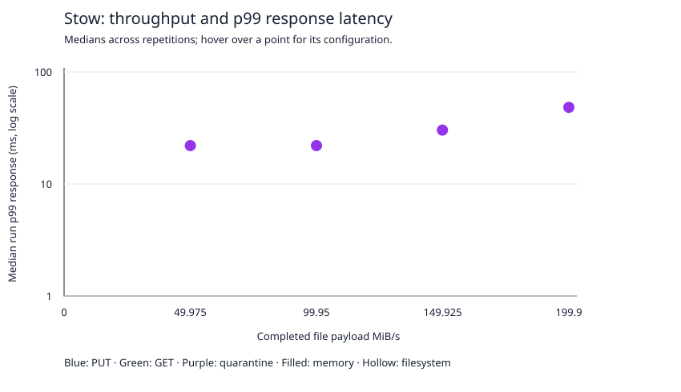

# Stow performance measurements

Profile: **Memory quarantine offered-rate sweep; loopback HTTP**. Recorded 2026-10-13T12:33:40.422Z.

Measurement windows: 20 s; warm-up: 5 s; repetitions: 3; soak: 0 s per backend.
Scanner delay: 2 ms; retained fixtures: 16; queue capacity: 8; file deadline: 10000 ms.
Suite complete: **true**. See [effective configuration](config.json) and [raw run index](suite.json).

**Exploratory measurements. The public capacity protocol has not been completed.**

Source commit: `e7140fde9fc605b8213960a06d5e139e9b81d893`. Dirty checkout: **true**.
Machine: Apple M1 Pro; 16 GiB RAM; darwin arm64; 23.5.0.

| Backend / workload | Bytes/file | Concurrency | Offered files/s | Runs | Completed files/s | Payload MiB/s (min–max) | Successful RPS | Median run p99 response ms | Peak sampled server MiB | Failed / dropped |
|---|---:|---:|---:|---:|---:|---:|---:|---:|---:|---:|
| memory / quarantine | 1048576 | 4 | 50 | 3 | 50 | 50 (50–50) | 250 | 22.027 | 56.719 | 0 / 0 |
| memory / quarantine | 1048576 | 4 | 100 | 3 | 99.95 | 99.95 (99.9–99.95) | 499.9 | 22.027 | 54.313 | 0 / 0 |
| memory / quarantine | 1048576 | 4 | 150 | 3 | 149.85 | 149.85 (149.3–149.85) | 749.5 | 30.287 | 57.281 | 0 / 12 |
| memory / quarantine | 1048576 | 4 | 200 | 3 | 199.9 | 199.9 (191.45–199.9) | 999.6 | 48.346 | 61.531 | 0 / 168 |

## Measurement scope

- S3 over loopback HTTP, SigV4 signing, AWS SDK, keep-alive connections and one attempt per request. TLS and separate-host networking are unmeasured.
- Quarantine performs PUT, verified GET, simulated scanner delay, verdict PUT and two DELETE requests per successful file. No real scanner or traffic blocking runs.
- Payload throughput counts completed file workflows during the measurement window. RPS counts successful individual API requests during that window. Verdict bytes are separate in raw operation metrics.
- Response latency includes scheduled-arrival queue wait. Service latency starts when a worker takes the file. Dropped arrivals have no latency sample and are reported separately.
- File deadlines include queue wait. Queue-expired files count as failures without issuing API requests or contributing service-time samples. A timed-out mutation can have an unknown outcome; it is not reported as confirmed corruption.
- Accepted work drains after the window. Drain completions enter latency histograms but do not increase window throughput. Resource observations include drain.
- Histograms use bounded bins with approximately 1% resolution. p99 needs enough observations; inspect minimumCompletedSamples in summary.json.
- Fixtures contain random bytes. PUTs reuse one key per worker and change a sequence prefix. Quarantine reuses worker keys after deletion. These test bounded retained sets, not unlimited ingestion.
- Reads stream through SHA-256 verification. Generation, hashing, SDK and verification costs are included in client-observed results.
- Warm-up and measured activity share a warmed server and filesystem cache. Cold-cache disk performance is unmeasured.
- RSS is sampled, not an OS high-water guarantee. CPU sampling uses process CPU time. Allocation rate is unavailable here; embedded Go benchmarks report allocations separately.
- Linux process I/O counters are recorded when available. Other platforms report null. Retained footprint is not cumulative disk write volume.
- Disk headroom is checked before each run and sampled during load. Inspect diskHeadroomMaintained in summary.json before accepting a result.

## Recovery

Not measured.
This checks process restart after completed writes. Power failure and interrupted publication are unmeasured.

## Publication

Publish a workload-specific claim with its hardware, backend, object size, concurrency, duration, configuration and raw results. Publish variation and failed/dropped counts.
Review scheduler lag and generator CPU before accepting a capacity result. Growing queue wait or large scheduling lag can indicate an overloaded client or server.
The chart includes overloaded points. Zero errors, verified data and stable queueing are required before describing a rate as sustainable.
This report does not establish production readiness, a latency SLA, crash durability under power loss, or DPI line-rate capacity.
