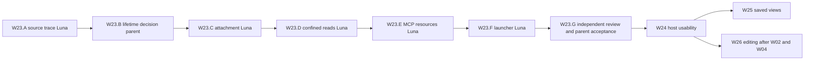
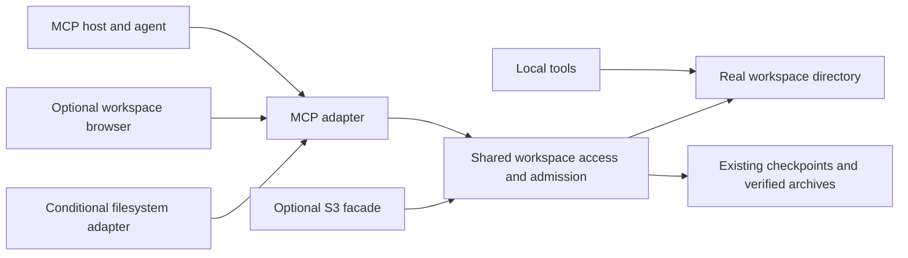
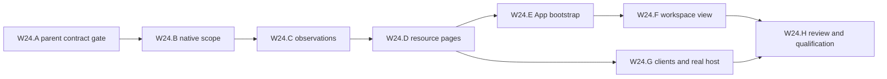

# Workspace access through MCP resources

**Status:** W23/W24 qualified for the declared local native profiles on 2026-11-11; see the [W24 qualification](../reviews/2026-11-11-workspace-resource-hosts.md). W25 local saved views/ranges/adoption are [qualified](../reviews/2026-11-11-checkpoint-resources.md); broader W25, W26–W28 and unverified platform/live App-host gates remain open.
**Source baseline:** `68132194` plus the W23 working-tree changes.
**Work order:** W23–W28 in the [consolidated plan](../development/storage-foundation-plan.md)
own scheduling and status. This document expands their contracts and acceptance.

Stow should let an agent use the same durable workspace through a local directory
or an MCP connection. The core investment is discoverable working files, clear
read identities, safe saves and portable checkpoints. A user should be able to
connect an agent, give it the right files, and continue elsewhere without manually
rebuilding its working context.

Filesystem mounting and executable discovery are conditional integrations. They
advance only when a named consumer needs them and the simpler workspace interfaces
have proved useful. Stow continues to own storage; callers own execution, model
context, writer coordination and sandbox enforcement.

## Execution mission and key results

Deliver the smallest useful additional access path to Stow's existing workspace,
then qualify editing and continuity through the same storage foundations. The
execution order and owners below expand W23–W28; they do not create another queue.

1. A host-written working file is discoverable and byte-identical through MCP
   while its caller still uses the directory, without widening the configured scope.
2. A real agent host completes useful reading/review without copied file bodies;
   an independent client verifies the resource interface.
3. A saved checkpoint stays stable across working edits, and a fresh receiver
   continues meaningful work with source storage unavailable.
4. Qualified managed clients save without silent lost updates, and resolve an
   interrupted save without blind retries. External-writer limits stay explicit.
5. Setup and reconstruction effort improve in repeat use; mounting or executable
   discovery proceeds only if a named consumer demonstrates a remaining obstacle.

## Execution assumptions and locked decisions

Execution of W23 was authorized on 2026-11-11. Later W24–W28 retain their product
and consumer gates. Deployment, model-provider spending, publication and outreach
remain separate actions. Existing working-tree changes,
including package artifacts, belong to their current owners and must be preserved.
The source baseline above is dated; an execution owner rechecks HEAD and affected
files before patching. Prior test receipts do not verify later code.

The fixed parent chat owns product scope, architecture and acceptance. Configurable
subagents default to the tool-supported `gpt-6-luna` at `medium` reasoning, using
fresh contexts (`fork_turns: none`) with self-contained briefs. Reuse those contexts
for sequential work via `followup_task`; IDs denote deliverables, not launches.
The runtime currently permits four concurrent agents including the parent, but
the ordinary implementation sequence needs only one writer at a time.

Locked choices are the existing storage/execution boundary, one configured native
workspace first, stdio first with shared adapter semantics, regular files only,
read-only resource-only mode, bounded operations, and reuse of existing identity,
rooted I/O and checkpoint formats. Preserve existing default commands. Path/URI
details in the proposed contract become binding only after W23.B reconciles them
with the actual SDK and filesystem seams. No new durable coordination format is
preauthorized merely to make attachment convenient.

W23.B settled standalone read attachment lifetime in the
[v1 implementation contract](../contracts/workspace-resources-contract.md): shared
reader leases, separate from writer sessions and capture, with an exclusive gate
on registered removal. This uses OS-released advisory locks without a lease journal.
`OpenWorkspace` unconditionally acquires the exclusive session lock; it cannot
simply open a second live workspace handle. Existing MCP fixtures hold a workspace
while testing checkpoint tools, which does not prove a second file attachment.
Reuse `LookupWorkspace` for resolution and rooted reads for confinement, then
settle how an attachment prevents collection if the original caller exits.
Relevant source: [OpenWorkspace](../../pkg/stow/workspace.go),
[session lock](../../internal/storage/workspace/session.go),
[collection](../../internal/storage/workspace/registry.go) and
[MCP fixture](../../internal/mcpstorage/server_test.go).

## Orchestration pattern and team

Use a dependency pipeline. Storage/lifetime work precedes adapter work; resource
registration and command changes are serialized under one adapter owner. Browser
work may run beside later storage work only after the resource contract freezes
and file ownership is disjoint. W25/W26 share storage paths and must serialize
their writes unless the parent explicitly partitions them.



| Owner | Dispatch and exact model | Work and success criterion |
| --- | --- | --- |
| Parent | Current chat; no separate model invocation | W23.B, architectural review and final acceptance; settle lifetime/collection before code and reject scope growth without a requirement. |
| Storage owner | Persistent `spawn_agent`, `gpt-6-luna`, `medium`, fresh brief | W23.A/C/D sequentially; confined reads and attachment lifecycle pass while an original caller is live. Reuse for later bounded storage slices. |
| Adapter owner | Persistent `spawn_agent`, `gpt-6-luna`, `medium`, fresh brief | W23.E/F sequentially; correct resources and opt-in launch profile without legacy API regressions. Reuse for W24 adapter/docs work after rebriefing. |
| Independent reviewer | `spawn_agent`, `gpt-6-luna`, `medium`, read-only | W23.G after integration; inspect confinement/liveness/protocol invariants and run prescribed checks without patching another owner's files. |

Execution used the retained Luna source-trace context for storage, a second Luna
for the adapter and a third read-only Luna for independent review, all at medium
reasoning. Adapter preparation overlapped stable native work against the frozen
contract; acceptance waited for integration. The parent settled lifetime and
reviewed integration. No non-Luna subagent was needed.

Escalation: supply missing facts or narrow the local task after the first blocker.
After two failed bounded attempts, isolate the remaining question for parent
resolution; use a stronger subagent only if that specific unresolved question
requires it, documenting the reason and actual supported override. Return routine
edits to Luna. Do not upgrade a whole workstream or assume an unavailable model ran.

## Dispatch briefs and ownership

Each dispatch includes the current revision, relevant plan section, exact owned
files, decisions already settled, dependency receipt and the command to verify
the slice. Ask for changed files, source references, checks with outcomes, and
concrete blockers in a short handoff. Store verbose logs only in the established
evidence locations. No agent may change module versions, generated package output,
another owner's files or accepted ADRs as an incidental fix.

**Storage batch W23.A/C/D:** inspect `pkg/stow/workspace.go`,
`internal/storage/workspace/{session,registry,rooted_reads,layout}.go`,
`pkg/stow/checkpoint_external.go` and their existing tests. W23.A is read-only and
stops when it identifies the attachment/collection boundary. After W23.B, own only
the approved attachment implementation/tests and bounded-read implementation/tests
in `internal/storage/workspace/` and `pkg/stow/`. Proposed new files are
`attachment.go`, `attachment_test.go`, `workspace_read.go` and
`workspace_read_test.go` in those respective layers; W23.B freezes the exact list
and any unavoidable existing-file edits. Reuse rooted I/O and the current collector;
do not add another registry or weaken liveness checks. Done means the storage
acceptance cases pass with no dependency on an MCP mock.

**Adapter batch W23.E/F:** inputs are the approved read interface and existing
`internal/mcpstorage/{server,browser}.go`, `server_test.go`, `cmd/stow-s3/mcp.go`,
`mcp_test.go`, `mcp_http.go` and process tests. Own proposed
`internal/mcpstorage/workspace_resources.go` and its test plus
`server.go`, `cmd/stow-s3/mcp.go` and focused MCP/process tests. Serialize E then F;
do not touch the storage owner's files. Register an overview, one bounded tree
page and file template, and ensure resource-only capability/tool behavior is
tested. W23 returns a complete bounded page or explicit overflow; full paged
navigation remains W24. Keep object mode and normal workspace defaults unchanged.
Done means a real stdio subprocess lists and reads ordinary file bytes and closes
the attachment on disconnect; HTTP registration uses the same surface.

**Review W23.G:** read integrated diff and W23 acceptance; own no production files.
Check root/symlink swap, lifetime/collection and no-write-resource invariants,
then run the focused commands below. Report blockers with file/line evidence and
which requirement they violate. The original owner repairs findings. Stop after
one independent review and a focused recheck of consequential fixes; reopen review
only for new changes or an unresolved failure. Parent inspects the lifecycle and
publication contracts before accepting, rather than treating passing mocks as proof.

## Enumerated execution backlog

W23 sub-IDs live under canonical W23. Each parent decision records a short result
here or in the resource contract; it does not spawn another planning queue.

| ID | Deliverable and exact target | Owner and model | Depends on | Done when |
| --- | --- | --- | --- | --- |
| W23.A | Trace `OpenWorkspace`, `AcquireSession`, collection and MCP fixtures; no edits | Storage Luna medium | Current source | Complete: exclusive writer-session boundary identified from source. |
| W23.B | Freeze lifetime and v1 read contract in `docs/contracts/workspace-resources-contract.md` | Parent | A | Complete: independent shared reader lease and exclusive registered-removal guard. |
| W23.C | Implement attachment and lifecycle/collection regressions | Storage Luna medium | B | Implemented; focused races pass, including kill release and attached-only collection refusal. |
| W23.D | Confined bounded reads and descriptor-based directory metadata | Same storage Luna context | C | Implemented; focused races cover private parent paths, symlinks/FIFO, construction failure and identity. |
| W23.E | Add `workspace_resources.go` and resource tests through a wrapper around the existing server | Adapter Luna medium | D and frozen contract | Implemented; resource-only capabilities, scopes, errors and bounds pass MCP fixtures. |
| W23.F | Opt-in flags and transport lifetime in `mcp.go` plus process tests | Same adapter Luna context | E | Implemented; stdio shutdown/kill and shared HTTP lifetime pass focused tests. |
| W23.G | Independent review, integrated checks and dated evidence | Reviewer Luna medium; parent accepts | C–F | Complete for local native development: independent review/rechecks, standards, four conformance profiles and final affected races passed. [Qualification](../reviews/2026-11-11-workspace-resources.md). |

Later work retains its stable W24–W28 IDs and the detailed acceptance below. It is
deliberately not delegated as whole features. The following readiness gates name
the next bounded batch; the parent must freeze exact edits before dispatch.

| Work | Accountable owner | Next decomposition and readiness gate |
| --- | --- | --- |
| W24 | Parent; bounded Luna batches | [W24.A–H](#w24-execution-backlog) specify static folder scope, native observations, resource paging, App integration, accessible UI and actual-host qualification. No TypeScript/Python launcher API or directory-page tool is needed. |
| W25 | Parent; storage then adapter Luna medium | Settle retained-view lifetime with W03/W05, then separately implement saved-file lookup/ranges near existing checkpoint code, resource registration, and the existing `examples/opencode/` continuation fixture. Lock payload integrity/hold semantics before editing storage. |
| W26 | Parent; storage then adapter Luna medium | Under W02, split resource observations, publication comparison, request journal/reopen resolution and MCP bindings into separate bounded edits/tests. Freeze host-writer coordination and crash boundaries first; a generic “implement guarded saves” dispatch is prohibited. |
| W27 | Parent; bounded Luna research only after consumer gate | Compare materialization and existing S3 adapters first. Select an OS and exact mount library only if evidence justifies a mount; implementation ownership cannot be assigned before that decision. |
| W28 | Parent; bounded Luna example only after caller gate | Start with ordinary README/scripts in a named consumer. Select descriptor files and caller adapter only after documentation proves insufficient; no Stow execution subsystem. |

## Execution scope and verification gates

The first implementation boundary was W23.A–G; W24.A–H is now qualified for the
declared local profiles. W25.A–G are qualified for the local scope below; broader
W25 continuation and W26 remain open, with the
W02/W03/W04/W05 prerequisites shown below. W27/W28, arbitrary MCP
mounting, writable POSIX semantics, notifications, protected multi-tenant service
claims and universal agent-host support are outside that first slice. These
guarantees remain open; accepting W23 does not complete the broader product gate.

The most consequential risk is collecting or mutating a live workspace through
an incorrectly attached reader. W23.B blocks implementation until its lifetime
contract is explicit. Other risks and backout follow the proposed contract and
release section below: disable the adapter, preserve ordinary files/identity, and
version any approved durable state. Never solve a failed regression by weakening
collection, confinement, policy or receipt guarantees.

Run the following existing commands during execution, with new regressions added
alongside their affected code. These are scheduled checks, not results of this
planning pass. Inspect prerequisite scripts and the current tree before running
targets that install/build or regenerate package artifacts.

```sh
# Focused storage and adapter regressions, including the proposed new tests.
GOTOOLCHAIN=go$(tr -d '\r\n' < .go-version) go test -race \
  ./internal/storage/workspace ./pkg/stow ./internal/mcpstorage ./cmd/stow-s3

# Exact integrated implementation gates after review.
make standards
make test-conformance

# W24 UI slice when changed; use the existing dependency preparation first.
make check-mcp-browser

# Documentation-only planning verification.
node scripts/check-doc-links.mjs
git diff --check
```

On this sandbox, use an allowed temporary `GOCACHE` if the host cache is not
writable; changing the cache location must not change which tests run. W24 wrapper
changes additionally require `make test-node`/`make test-python` for affected
languages. W25 real-host continuation and W26 fault/process tests supplement local
suites; `make test-agent-real` spends provider resources and runs only within an
authorized integration exercise. Never infer a live pass from a mock or compile.

Acceptance maps results 1–2 to W23/W24, result 3 to W25/W19, result 4 to W26/W02,
and result 5 to W22 and the conditional gates. A release receipt names the exact
artifact, OS and host. W23.G may close a local implementation slice while remote,
second-host or release gates remain open; it may not mark those outcomes complete.

The reviewable deliverable is the W23 resource prototype and its contract/evidence,
with canonical W23–W28 retained. Authorized execution uses W23.A's trace and the
recorded W23.B contract, then C → D → E → F → G. It produces a narrow resource
prototype first, not an automatic public release. No commit, push, deployment or
publication is part of this execution slice.

## Product judgment

Workspace resources strengthen the existing product because they expose the
directory, identity and saved work Stow already owns to another class of caller.
They do not require a second copy of the workspace or an agent-specific storage
format. Their value is access and continuity, rather than MCP support by itself.

The product should remain **portable working storage for agents, tools,
applications and tests**. Describe the new capability as “connect an agent to your
workspace.” A resource-only connection is a useful profile for reading, inspection
and review. It is not the product's defining abstraction or an editing protocol.

The extension earns continued investment when users need fewer setup steps, spend
less time reconstructing inputs and can verify resumed output. It detracts from
the product if it introduces another registry, a synchronization engine, a hosted
agent runner, or a large filesystem compatibility obligation without repeat use.

### Boundaries to preserve

- Reuse real workspace files, the embedded runtime, registry, authority/policy,
  checkpoints, receipts and archive validation.
- Local tools continue to work in an ordinary directory. API permissions do not
  constrain a process that already has host filesystem access.
- Keep the existing object store and its MCP browser working. Its record directory
  is not a workspace directory and must never be opened as one.
- Host configuration selects a workspace and exposure scope. Resource URIs,
  cursors, model arguments and client roots cannot widen that scope.
- File contents, instructions and scripts are untrusted data until the caller
  decides how to use them. Reading, previewing or importing does not execute them.
- A connection grants storage access, not access to process memory, chat history,
  credentials or remote side effects. A checkpoint captures saved work, not success.

These boundaries follow [ADR 0008](../adr/0008-workspace-backend-real-files.md),
[ADR 0014](../adr/0014-storage-product-caller-owned-execution.md),
[ADR 0016](../adr/0016-scoped-access-encrypted-cache.md), and the
[workspace contract](../workspace-contract.md). No new hosting service is required.

## User experience

### Connect and inspect

A developer prepares a workspace using the existing CLI or wrapper, adds inputs,
and connects an agent to its registered ID. The connection exposes a short
workspace overview, a paged directory tree and file references. The agent reads
instructions and selected inputs on demand. It does not receive every file in its
initial context.

The local agent uses the ordinary directory. An MCP host reads the same working
files through resources. A host that exposes only manual resource selection may
require the user to select files; Stow must document that behavior for that host.

### Edit and save

After the workspace backend qualifies for managed saves, an agent can request an
observation, submit an edit and resolve an uncertain save using the original
request identity. A resource preview alone is not a save observation. Conflicts
leave current bytes intact and allow the caller to reread and revise its draft.

The user sees whether a file is current working data or a saved checkpoint,
whether the connection permits edits, and whether a save committed. Saving a file
and creating a checkpoint remain separate actions.

### Continue elsewhere

The caller pauses writers, captures a checkpoint and exports a verified handoff.
A receiver adopts it under a new local workspace identity, connects another agent
and continues from ordinary files. A saved progress document may provide goals,
decisions and remaining work; Stow neither invents nor restores conversation state.

Old resource references do not silently redirect to the adopted workspace. The
handoff result supplies the receiver's identity and root references, retaining
source provenance without implying source permissions.

### Workspace browser

Extend the existing MCP App browser rather than starting a dashboard product.
Show workspace name/ID, working or saved view, breadcrumbs, a bounded file list,
preview, size, read limits and connection capabilities. Offer copying a resource
reference or local path only when the host actually has that path.

Checkpoint inspection and transfer actions reuse existing operations and appear
only when available. Pending, denied, conflict, changed, too-large and unavailable
states need distinct messages. Keyboard navigation, focus restoration, readable
binary/empty states and cancellation are release requirements. Untrusted HTML is
displayed as text or a constrained preview, without loading workspace scripts or
remote assets. CLI and plain resources must remain useful without the App UI.

## Existing implementation and required extensions

| Concern | Reuse | Required extension |
| --- | --- | --- |
| Directory and bucket over the same bytes | [Workspace](../../pkg/stow/workspace.go), [workspace store](../../internal/storage/workspace/objects.go), [facade](../../pkg/stow/workspace_facade.go) | A scoped read attachment that can coexist with a caller using the directory. |
| Confined reads | [Rooted reads](../../internal/storage/workspace/rooted_reads.go), existing root/symlink tests | Apply confinement to traversal, metadata, previews and checkpoint payload access. |
| Workspace MCP | [Server](../../internal/mcpstorage/server.go), capture/inspection/handoff adapters | File resources, resource-only profile, lifecycle and explicit feature negotiation. |
| Object MCP | [Object server](../../internal/mcpstorage/object_server.go), [browser](../../internal/mcpstorage/browser.go) | Share transport/UI utilities where semantics match; preserve distinct backends and limits. |
| Safe writes | [Runtime managed saves](../../internal/runtime/guarded_save.go), durable native receipts | Workspace qualification under W02; an object-store token cannot be reused as a workspace token. |
| Access control | Existing authority, resource policy and W04 enforcement work | Audit workspace file/list/checkpoint paths and enforce host-selected exposure before disclosure. |
| Saved files and transfer | Checkpoint capture, archive, restore and adoption | Authorized checkpoint read view, retained lifetime, destination references and bounded range reads. |
| Change notices | W08 durable observation and W09 readiness plans | Optional MCP invalidation adapter after those prerequisites qualify. |
| Distribution | Native CLI, thin TypeScript/Python wrappers and existing extension | Additive options, examples, host compatibility receipts and exact-artifact checks. |

The object browser serves one owned object-store bucket, not the contents of an
arbitrary workspace directory. Its resource payload ceiling remains 64 KiB.
Workspace MCP provides checkpoint operations and a workflow guide by default;
the W23 development profile adds opt-in file resources with a separate read lease.
The workspace store does not implement the native managed-save capability;
ordinary conditional puts do not close that gap.

The policy engine and several enforcement paths already exist. Their presence
does not establish per-client scoped authentication in the MCP launcher, or prove
every new enumeration and historical read path. Qualify the selected profile
against current source; do not treat broad roadmap prose as a shipment claim.

## Architecture



This is an adapter over the workspace, not a copied object store. Add only the
small shared operations missing from the current runtime: confined enumeration,
bounded file reads and saved-view lookup. Keep policy, comparison and publication
below protocol/UI wrappers. Do not build a generic virtual filesystem framework
before a second concrete backend requires one.

The in-process host can lend its existing runtime. The standalone MCP launcher
needs an explicit attachment lifetime that retains identity and prevents eligible
collection while connected, without taking ownership of execution. First prove
that it can attach while a caller's workspace handle is live. If existing open
semantics rewrite identity, contend on exclusive ownership, or mutate read-only
state, add a narrow read attachment rather than creating a second store.

The first native profile is a host-configured single workspace. A shared bearer
token identifies that configured connection boundary; it does not establish
separate principals for each client. Per-client multi-tenant service deployment
depends on W04 and its host identity integration and is outside the first release.
Reuse explicit remote exposure controls and host TLS termination. Audit Origin
validation and session/auth behavior for the selected transport before widening
deployment claims.

## Proposed resource contract

The [v1 contract](../contracts/workspace-resources-contract.md) fixes the implemented
W23/W24 profiles. Saved views and notification extensions below remain proposed;
the contract and generated API reference govern current names and limits.

### Resource identities

| Resource | Proposed URI shape | Meaning |
| --- | --- | --- |
| Workspace overview | `stow://workspaces/{id}/v1` | Identity, selected view, features, bounds and navigation roots. |
| Directory observation | `stow://workspaces/{id}/tree/{encoded_path}` | Complete bounded direct children in W23; W24 adds the separate versioned paged route. |
| Working file | `stow://workspaces/{id}/files/{encoded_path}` | Current bytes at read time. |
| Checkpoint overview | `stow://workspaces/{id}/checkpoints/{checkpoint_id}/v1` | Saved identity, completeness, exclusions and navigation. |
| Checkpoint file | `stow://workspaces/{id}/checkpoints/{checkpoint_id}/files/{encoded_path}` | Retained immutable saved bytes. |

Use canonical base64url encoding of the UTF-8 relative path as a single URI
component, extending the existing object-reference convention. Show the readable
path in resource names and directory entries. Reject noncanonical encodings,
traversal, absolute paths, NULs and invalid UTF-8. Do not normalize distinct
filenames into the same identity. Final URI length bounds must cover the selected
path ceiling and encoded expansion.

File paths identify ordinary regular files under the working root. Exclude Stow's
private directory and the connection's configured exclusions. Symlinks, sockets,
devices and FIFOs are not file resources in the first profile. Ordinary hidden
files require the same explicit exposure policy as other files; checkpoint
exclusions must not be assumed to protect live resource reads automatically.

Preserve the difference between a real path and an object key. Keys stored in
Stow's escaped layout, file/directory name collisions and additional buckets need
their existing object namespace, not fictitious physical paths. Empty directories,
symlinks and executable modes are not portable file guarantees merely because a
tree UI can display them. Record what the first profile preserves and refuses.

### Discovery and resource-only operation

`resources/list` exposes a bounded set of workspace roots/guides; template discovery
uses `resources/templates/list`. Neither eagerly registers every file. Reading a directory
resource returns versioned JSON containing readable paths, file/directory kinds,
resource URIs, sizes when cheaply available, continuation and observation time.
Directory resources link to child directory pages. Standard resource-list
pagination and directory-page continuation remain distinct contracts.

The resource-only profile registers no tools or prompts and advertises only the
capabilities it implements. It includes enough root instructions and navigation
to browse using resource reads. The normal workspace profile retains current
tools; a host-specific browse tool may be a thin adapter for clients whose agents
cannot navigate resources directly. Avoid a broad tool per filesystem operation.

MCP resources are application-driven, and listing, reading, templates and optional
subscriptions are separate protocol features. Host support must be verified rather
than inferred from the ability to connect. See the
[MCP resource specification](https://modelcontextprotocol.io/specification/2025-11-25/server/resources).
The directory JSON and range conventions in this plan are Stow contracts, not
universal MCP filesystem behavior.

Development launch shape:

```sh
# Opt-in development profile; existing commands retain their defaults.
stow-s3 mcp --registry-dir /absolute/registry --workspace-id WORKSPACE_ID \
  --workspace-files --resources-only --timeout 30s
```

Resource-only access must not require enabling the App browser or write tools.
Choose host-owned configuration for allowed roots, exclusions, read ceilings and
optional write scope. Do not embed bearer tokens in URIs or handoff documents.

### Bounded reads and directory observations

Initial proposed defaults are 100 directory entries per page, 64 KiB decoded file
content, 256 KiB complete encoded response, eight concurrent reads, a 10-second
operation deadline and five-minute directory cursors. Encoded size includes JSON,
URIs and binary base64 expansion. Host configuration can narrow limits. Measure
before raising them; preserve existing object-server ceilings.

Page size alone does not bound a filesystem walk. The initial profile admits a
maximum 10,000-entry directory observation, with explicit scan, time and memory
ceilings. If traversal cannot complete within those bounds, refuse the observation
as too large rather than presenting a partial tree as complete. W16 measures
10,000 and 100,000-file workloads before extending this ceiling or indexing model.
Never create an unbounded process-wide list merely to return a small page.

Cursors bind workspace, view, root, scope/configuration revision, directory
observation and continuation position. A bounded cached observation can preserve
page order while live files change; it is not a snapshot of their bytes. Recheck
current authorization on each page, expire observations and release them on close.
Old/revoked cursors fail without revealing previously listed names.

Working reads are explicitly current and mutable. Read through confined handles,
bound bytes while reading, detect observable changes and return changed/unavailable
when consistency cannot be established. Metadata, length and time checks cannot
prove a snapshot against arbitrary in-place host edits. Callers needing a stable
multi-file basis pause writers and use a checkpoint.

Small files return text when the media type and UTF-8 allow it, otherwise binary.
Never silently truncate a resource while calling it complete. Oversize files return
a bounded error with allowed next steps. W25 adds checkpoint byte ranges through
an explicit Stow template and shared range reader; it does not enlarge every read
or chunk an unstable live file into a false coherent revision. Bound offsets,
lengths, integrity work and aggregate concurrent memory. Repeated reads close
handles on cancellation and error.

### Authorization and disclosure

For the first trusted local profile, an operator explicitly chooses the exposure
scope. Default exclusions cover Stow internals, credentials and common private
paths, with an inspectable configuration. Add directory exposure controls to a
shared access boundary rather than hard-coding filters independently in the UI.
An ignore rule is a disclosure control for this connection, not an OS sandbox.

For protected profiles, W04 supplies trusted identity, policy and revocation.
Authorize before listing names, obtaining metadata, returning cached pages,
reading bytes, reporting counts or errors, and resolving saved versions. Implicit
browse results include only visible entries and visible counts; explicit forbidden
path requests refuse without confirming existence. An explicitly requested full
scope must not silently become a filtered partial export or checkpoint.

Read permission, save permission, capture and export are separate decisions.
Historical access requires current authorization to the requested saved scope.
Capabilities describe support and bounds, not a permanent grant. Logs and errors
avoid host paths, tokens and names outside the authorized scope.

### Guarded editing

Use the shared managed-save semantics from W02: resource-bound observation or
expected absence, deliberate replacement when authorized, a persisted unique
request key, and committed/not_committed/unknown outcomes. Reuse the original
request meaning on retry and resolve uncertainty before starting another save.
Namespace request journals by workspace identity and bind receipts to the exact
path and operation. Denial, conflict, unavailable and unsupported remain distinct.

Workspace implementation must address file publication followed by index/journal
failure, restart resolution, quotas, directory creation, read-only attachment and
changes made by host tools. Do not add a wrapper-level check-then-put substitute
for core admission. Qualify an initial managed-writer profile with external writers
quiesced or host-coordinated; refuse stronger atomic claims when a host can race
the publication. Do not hold a process-wide execution lock and call it filesystem
enforcement.

First expose bounded whole-file saves. Leave rename, deletion, multi-file
transactions, patches and large uploads to separate demonstrated requirements.
Existing APIs retain their existing behavior. Resource-only connections never
gain write effects through a URI read.

### Checkpoint lifetime and notifications

Checkpoint references pin an identity, not infinite retention. Reuse W03 holds
for an explicit saved-view lifetime, releasing the connection's holds on close
and reconciling them after crashes. Define bounded expiry and who can extend it.
After pruning or expiry, return unavailable/gone; never substitute current bytes.
Verify checkpoint/workspace association, payload confinement and integrity.

Add MCP change subscriptions only after W08 provides qualified observation.
An MCP update is a hint to reread; it is distinct from W08 durable replay and W09
ready-output publication. Stateless HTTP may require polling or an explicit
sessionful profile to deliver unsolicited updates; qualify that transport before
advertising subscribe/listChanged. Existing sessionless operation must keep working.
See the [MCP transport specification](https://modelcontextprotocol.io/specification/2025-11-25/basic/transports).

## Delivery phases and acceptance

W23–W28 below are expansions of the canonical queue, not independent status
records. Estimate ranges are engineering effort for one experienced engineer,
exclude existing W02/W04/W03 prerequisite work, and are not calendar commitments.
Re-estimate after W23. No phase authorizes deployment, registry publication,
model spending or outreach.

### W23 Prove one workspace through resources

**Effort:** 3–5 engineering days. **Depends on:** current workspace and MCP baseline.

Freeze a short draft contract covering identity, path encoding, scope, errors,
read bounds and attachment lifetime. Resolve the live-handle attachment question
with executable tests. Add one root, one bounded directory resource and regular
file reads for a configured read-only workspace. Support stdio first; share the
surface with HTTP rather than implementing it twice.

Acceptance: an ordinary host-written file is discoverable and returns identical
bytes through MCP while the caller's workspace handle is open. Close/disconnect
does not destroy or change workspace identity. Private paths, traversal and
symlink/root swaps refuse. Killing the MCP process leaves a resumable directory
and no permanently live collection protection. A pinned MCP test client can
browse without any tools registered. Record host support assumptions explicitly.

### W24 Make workspace reading usable in real hosts

**Status:** Complete for the declared native macOS ARM64/OpenCode resource-only profile, 2026-11-11; [qualification](../reviews/2026-11-11-workspace-resource-hosts.md). **Depends on:** qualified W23; W04 only for
protected policy claims. **Effort:** approximately 10–18 engineering days for one
experienced engineer, including the scoped UI integration, excluding unavailable
host/model access. This replaces the earlier 5–10 day estimate; re-estimate after A.

#### W24 mission and key results

Make a workspace with more than 100 files usable by a real agent and by a person
browsing it. Preserve ordinary files and the W23 read-only contract; make the
agent's connection easier to configure and its read scope clear.

1. A caller traverses every entry of an admitted directory observation without
   duplicate/skipped pages from rescanning a changing directory.
2. Host-selected folder scope applies to direct reads, observations, cached pages
   and App navigation, including sensitive-parent and Unicode alias regressions.
3. One pinned real agent reviews synthetic inputs through MCP resources with no
   manual copying of file bodies; a TypeScript client independently verifies paging.
4. The existing browser gains keyboard-operable workspace navigation and truthful
   states while its bucket behavior and resource-only/no-tool profile stay intact.

The observations freeze names/metadata only. File reads still return current
bytes; W25 owns immutable saved views. No watcher, filesystem mount, write tool,
agent runner, provider integration or new storage layout is part of W24.

#### W24 decisions and simplification

The source pass inspected the actual W23 collector and browser bootstrap. The
collector already reads bounded batches and uses rooted descriptors without
hashing bodies. Reuse it; do not add a second index. `ReadDirectory` must retain
its complete-result limit of at most 100 visible children, including its existing
overflow regression.

The first host target is OpenCode v2.0.16 at the existing pinned commit.
Its [resource tool source](https://github.com/anomalyco/opencode/blob/3a103fe0aff726a4edc7492f03f7b88195d9e4c9/packages/core/src/tool/plugin/mcp-resource.ts#L18-L80)
provides agent resource listing/reading with permission checks. This establishes
source eligibility, not successful model use. The current pilot neither registers
Stow MCP nor permits that tool profile, and its prompt asks for file writes.
Create an isolated resource-review recipe; do not relabel that file-only pilot
as evidence for this workflow or loosen its defaults.
Check availability of the exact executable early. If unavailable, the parent may
qualify an explicitly selected available host/version for this new recipe after
the same bounded capability check; do not bypass or silently change the legacy
pilot's pin. Missing access must not become weeks of unrelated host installation work.

Use resource URIs for paging and file reads in every profile. A new
`stow_workspace_browser` tool exists only to launch the optional App and return its
root reference. A directory-page tool or general filesystem tool suite duplicates
the resource interface and is unnecessary for the selected host.

The existing TypeScript/Python workspace helpers prepare/serve storage, rather
than configure MCP hosts. Keep them unchanged. Supply exact native command/config
examples; add a wrapper only after a second demonstrated caller needs one.

#### Static folder scope

Add optional host-owned `WorkspaceReaderOptions.ReadRoots` and repeatable
`--read-root` in workspace-file mode. Absence preserves W23's whole-workspace view
minus mandatory exclusions. Explicit values name existing relative directories;
they narrow the view and never override private exclusions. Normalize syntax with
the existing path rules, deduplicate roots and enforce a proposed maximum of 16.
Use literal path-segment boundaries: `inputs` cannot match `inputs-private`.

Direct file reads require an allowed root or descendant. Directory navigation may
show only ancestors necessary to reach selected roots and entries within those
roots; unrelated names/counts/metadata must not appear. Apply scope before metadata
disclosure in the shared native reader, rather than filtering only App results.
Caller-supplied file paths, cursors or resource URIs cannot widen it. Test alias
and symlink cases against the underlying filesystem rather than weakening W23.

This is an immutable host-configured read view, not a new principal/ACL engine.
Reconfiguration requires reopening the reader/server and invalidates old cursors.
Default sensitive exclusions remain mandatory. Resource ACLs, dynamic revocation
and protected multi-client authentication require W04 qualification and remain
open; W24 must not claim to have implemented them.

#### Bounded native directory observations

Extend the collector with `ObserveDirectory(ctx, path)` returning an immutable
metadata observation with `Page(ctx, offset, limit)`. These names are proposed
until A freezes signatures. The observation stores literal sorted names, kind,
observed size, observation time and directory identity, not file bytes or open
file handles. Its page operation rechecks the reader, current static scope, root
and observed parent directory identity through rooted descriptors. Replacement
or removal of that directory refuses; ordinary child edits do not reorder pages.
Returned entry slices are caller-owned so one caller cannot mutate cached metadata.
During construction, detect duplicate literal paths and observable parent-directory
changes and refuse a changed enumeration. Reaching EOF means the bounded scan
completed, not that the filesystem supplied an atomic snapshot. Unobservable
concurrent changes remain outside the claim; quiescence/saved views are required
when the caller needs a coherent point-in-time basis.

Native observation creation admits at most 10,000 examined entries (including
hidden entries), at most 10,000 visible entries and 4 MiB of charged metadata.
Charge names/paths and a conservative per-entry allocation allowance before
retaining entries; distinguish this accounting bound from measured process RSS.
Check context between entries/batches. Overflow/cancellation returns no partial
observation and releases temporary state. Do not retain a registry/capture lock
while scanning or hold an extra lease per observation. Closing the owning reader
invalidates all observations; W23's reader lease still owns liveness.

#### Resource pages and cursor lifetime

Keep W23's `tree/{path}` URI and JSON unchanged. Add separate proposed routes:

```text
stow://workspaces/{id}/tree-pages/v1/{path}
stow://workspaces/{id}/tree-pages/v1/{path}/{cursor}
```

The first read builds an observation; continuation reads slice the retained
metadata without rescanning or hashing files. Return `observation_id`,
`observed_at`, mutable-view labeling, `entries`, `observation_complete: true`,
and page metadata containing the actual offset/count and optional `next_uri`.
That completeness describes the admitted observation, not all entries being in
one page. Consumers follow `next_uri` verbatim. Add overview feature/limit fields
and paged-directory root references without removing existing v1 fields.

Pages contain at most 100 entries and must fit the existing 256 KiB whole encoded
MCP result limit, including double JSON escaping and URI overhead. Reduce the
entry count when needed and advance by the actual count; never silently drop an
entry or emit an empty nonterminal page. A single oversized entry refuses.

Keep the observation cache solely in the MCP server, with defaults of eight
observations, 16 MiB total charged metadata, five-minute absolute lifetimes and
one observation scan admitted at a time. The existing eight-call limit and
ten-second/cooperatively-cancelled read deadline remain. Reserve the scan's
4 MiB allowance before construction and include active page copies/serialization
in measured peak memory. Do not infer total memory from page size alone.

Use least-recently-used eviction when admitting a new observation, expired entries
first. A request retains its observation while forming its bounded response;
eviction cannot change that page's bytes. Expiry is absolute, not extended by
reads. An evicted/expired cursor returns the same path-free unavailable category
as other invalid references; the UI offers refresh. Cursors bind server lifetime,
workspace, scope revision, path, root/directory identity, observation and offset.
Use an unpredictable server-held observation identifier and validate offsets;
there is no need for a durable cursor journal or a new signing/key service.
Close clears cache/admission state. Sessionless HTTP shares it only within the
existing single configured workspace/host identity; it is not per-client tenancy.

#### Existing browser integration

Permit `--browser` with `--workspace-files` in workspace mode. Keep object-mode
behavior unchanged; reject workspace `--browser` without file resources and reject
`--resources-only --browser`. The App launch tool and workspace UI resource are
registered only for that explicit profile. Resource-only remains navigable without
any tool or App bootstrap.

Reuse the existing HTML/esbuild/Go gzip packaging pipeline. A workspace UI resource
may use `ui://stow/workspace-browser-v1` with a small escaped host-owned bootstrap
payload identifying mode/overview URI. It uses the same bundled assets as the
bucket UI; do not introduce a second build, REST endpoint or web dashboard. A
bootstrap payload avoids assuming that every host delivers an initial tool result.
Extend resource middleware only for the exact registered UI URI and keep unknown
URI errors path-free.

The existing imperative bucket view stays intact. New workspace controls use
locally vendored CHS UI-kit primitives in a scoped React view inside that same
bundle, with App SDK setup shared once. The inspected kit source is React-based
and uses utility CSS; its components are not drop-in vanilla DOM controls. A must
freeze the minimal React/React Aria and CSS build recipe, matching pinned kit
sources and licenses. Vendor button, breadcrumb, checkbox, pagination and status
primitives as needed; do not build custom equivalents or migrate unrelated views.
Map host theme variables through the app theme. Do not import the kit registry at
runtime, fetch assets from a CDN or fork behavior merely to change appearance.

The current bundle is 124,332 compressed bytes / 694,186 HTML bytes. Proposed
ceilings are 512 KiB compressed / 2 MiB HTML and a separately bounded 4 MiB encoded
UI-resource response; file/page limits stay unchanged. Measure the vendored slice
before expanding it. If it exceeds the budget, reduce imported surface or revisit
the integration in A; do not silently raise ceilings or waive the design baseline.
UI reads use bounded admission too; do not accidentally apply the file preview
limit to the App bundle or admit the same file request twice through middleware.

Show the workspace identity, relative folder breadcrumbs, read-only status, observed
entry count/age, page navigation, refresh, preview and explicit reference selection.
Do not expose cursor IDs or internal cache mechanics in product copy. A metadata
observation and a current preview need distinct labels. Preserve the host's composer
context, the existing ten-reference selection limit and capability-based fallback;
unavailable attachments must not disable browsing.

Design loading, empty, error, unavailable/offline, expired/changed and successful
states before implementation. Folder/page changes cancel or supersede earlier
requests so late responses cannot replace the current view. Restore focus to a
meaningful row/breadcrumb; preserve position on preview failure. Use visible text
status, 44-pixel primary targets, rem text, keyboard access, 200% zoom, contrast
checks and reduced-motion support. No rounded rows with colored side rails.
Display file names/bodies as text, with no executable HTML previews.

#### W24 orchestration and ownership

The parent owns A, contracts, integration and acceptance. Reuse the existing
storage and adapter Luna contexts; create one UI Luna only when its frozen inputs
are ready. All implementation/fixture assignments use tool-supported
`gpt-6-luna`, `medium`, fresh self-contained briefs when a new context is required.
Reuse an independent read-only Luna after source freezes. No stronger subagent is
scheduled. At most two writers run concurrently, with explicit disjoint ownership;
the root plus active agents remain within four runtime slots.



##### W24 execution backlog

Execution receipt, 2026-11-11: A–H are complete for the declared local profiles.
Native/MCP/CLI races, all four storage conformance profiles, standards, rendered
fixtures and the independent TypeScript resource client pass. The actual OpenCode
Free Router task passed with eight completed resource calls; the qualification
retains setup/verifier corrections and explicit remaining host/platform gates.

| ID | Deliverable and owned targets | Owner / model | Depends on | Done when |
| --- | --- | --- | --- | --- |
| W24.A | Freeze the additive contract in `docs/contracts/workspace-resources-contract.md`; confirm native API/cursor schema, UI vendor recipe, exact host executable/config and proposed budgets | Parent, no new model call | W23 + completed source research | No storage/transport/UI decision is left for an implementer to guess; source eligibility is separated from actual host access. |
| W24.B | Static folder scope in new `pkg/stow/workspace_read_scope.go`, reader options and existing file/directory entry checks; nearby tests | Retained storage Luna medium | A | Default W23 view unchanged; selected roots narrow every read/list path without leaking siblings or private aliases. |
| W24.C | Bounded observation/page type in new `pkg/stow/workspace_read_observation.go`; extract/reuse collector in `workspace_read_directory.go` and tests | Same storage context | B | W23 >100 refusal remains; large observations are bounded and immutable metadata; page reads validate identity/scope and return independent slices. |
| W24.D | New `internal/mcpstorage/workspace_resource_pages.go`/tests; explicit page-route parsing and scope-middleware allowlist changes in `workspace_resources.go` | Retained adapter Luna medium | C | Exact initial/continuation page routes navigate >100 entries through the actual MCP client; unknown/malformed/foreign routes remain path-free. Cache charge/count/expiry/LRU/cancel/close behavior and encoded limits pass. |
| W24.E | New workspace App registration/bootstrap helpers, `browser_ui.go` reuse, `cmd/stow-s3/mcp.go` flags/process tests; native `--read-root` forwarding | Same adapter context | D | Server tool/resource payloads and exact activation flags pass; old bucket/default/resource-only profiles remain intact. Rendered startup variants are verified in F. |
| W24.F | `extensions/stow/src/workspace/` controller/view/types/theme, minimal `app.ts` dispatch and `index.html` mount; vendored primitives, package/lock/build changes, UI tests and generated browser artifact/licenses | UI Luna medium, fresh brief | E + frozen schemas | Same bundle supports workspace navigation; kit behavior, keyboard/states, safe rendering, attachments/fallback and bundle budgets pass. |
| W24.G | New isolated `examples/workspace-resources/` recipe/fixtures/tests; narrowly scoped reuse of `examples/opencode/server.mjs` if needed; independent `extensions/stow/test/workspace-protocol.test.mjs` | Retained adapter context | D; actual run needs host/model access | TypeScript client independently pages/reads; real pinned host uses MCP-only resource reads for the synthetic review with verified answer and trace. No simulated model pass. |
| W24.H | Read-only integrated review, scoped repairs by original owners, current guide/compatibility matrix, qualification record and queue status | Independent Luna medium; parent accepts | F/G and profile evidence | Required checks pass, source is frozen before broad gates, actual outcomes/unsupported host features are explicit and no broader gates are silently closed. |

Storage owner writes only native reader/observation files and tests. Adapter owner
owns resource/CLI/App registration, recipe files and the specifically named
independent protocol test. UI owner owns extension source/build/package and UI
tests, excluding that protocol test; it does not edit Go registration. Sequence
adapter D → E → G; UI F may overlap G with those boundaries. Parent owns contracts,
guide, status and evidence integration; generated API text follows its generator.
Parallelism here covers disjoint source edits. Serialize dependency installation,
shared binary builds and generated bundle writes; G's client checks wait for F's
lockfile/dependency state to be stable. Do not let one agent's test setup replace
another's dependencies mid-check.

Each brief supplies the relevant contract section, exact files, dependency receipt,
locked choice, acceptance test and allowed write scope. Split B/C/D/F further at
function/test boundaries if a Luna brief stops being bounded, while retaining
these deliverable IDs. After a blocker, resolve missing context first; after two
failed bounded attempts, escalate only the unresolved question to the parent.
Run one independent review plus focused rechecks of consequential fixes, rather
than repeatedly rediscovering the same source.

#### Host recipe and acceptance evidence

Use a disposable synthetic workspace containing a brief and two small data files
whose deterministic mismatch answer is known to the caller. Place one necessary
input beyond the first 100 sorted entries so a correct trace must follow a page
reference. Include private/out-of-scope sentinel files that must not appear.
Prompt with the task and root reference, never input bodies or the expected answer.

Configure the pinned OpenCode process in isolated state outside the workspace,
register Stow's native resource-only command and permit only its MCP resource
list/read actions. Deny native file/shell/process/subagent access and use an empty
working directory outside the dataset. Reuse process shutdown/config scaffolding,
not the old caller's write-progress prompt or checkpoint controller. This remains
a caller-owned convention, not an OS sandbox. Verify exact permission/config
spelling against the pinned source before invoking a model.

Keep the first actual exercise bounded to one review task, at most two turns and
five minutes with no automatic model retry. Use an explicitly supplied provider/
model profile and its established spending controls; missing executable, access
or budget leaves this gate open. Do not inspect or copy credentials into fixtures,
logs, workspace files or handoffs. Planning itself starts no host or provider call.

Record resource list/read/page URIs, exact versions/artifact, task answer and
independent verification, setup time, manual interventions, close/reconnect and
failed attempts. A successful answer via native file tools is a failed resource
pilot. SDK mocks cannot pass it. The independent client uses the existing pinned
TypeScript MCP SDK from the extension; no new language wrapper is needed.

The compatibility matrix separately records resource discovery, agent navigation,
App rendering, composer references, transport and authentication profile. OpenCode
passed the declared resource-only task; the [receipt](../assessment-evidence/2026-11-11/workspace-resources-host.json) records exact versions and corrections. An AppBridge/browser fixture is
rendering/protocol evidence, not proof of a live App host. Qualify live App-host
claims only with a named actual host receipt; unverified App hosts do not block a
resource-only candidate or become advertised support.

#### Verification and backout

Add regressions beside each slice: default W23 behavior; scope boundaries and
Unicode aliases; stable metadata pages during child edits; current file reads;
parent/root replacement; count/byte limits including hidden entries; encoded page
packing; foreign/expired/evicted cursors; saturation/cancellation/reconnect; and
close cleanup. Browser tests cover breadcrumbs/back/next/refresh, late responses,
empty/binary/oversize files, unavailable references, keyboard/focus, narrow layout,
200% zoom and composer-context preservation. Keep bucket regression tests.

Use existing commands before introducing new targets:

```sh
make build
go test -race ./internal/rooted ./pkg/stow ./internal/mcpstorage ./cmd/stow-s3
make check-mcp-browser
npm --prefix extensions/stow test
make test-agent
make standards
make test-conformance
```

Use the pinned Go toolchain and allowed temporary cache as in W23; local-listener
tests require the reviewed execution path in this sandbox. F adds a rendered
workspace-view test through the existing browser-testing setup and wires it into
the browser gate; choose the exact invocation in A after inspecting that harness.
Do not replace rendered keyboard/zoom checks with the current fake-DOM test alone.
The opt-in real-host command belongs to G's recipe and must report missing access
as unverified, not a passing skipped test. Independent actual-host evidence is
separate from `make test-agent`'s current file-only fixtures.

Freeze sources before integrated gates; after a repair rerun affected checks and
retain precise evidence. Preserve pre-existing generated-file changes, use current
artifacts rather than installed carrier binaries, and never raise a ratchet to
admit new debt. Measure scan duration and peak memory on 100/1,000/10,000-entry
fixtures before supporting the new ceilings; oversized/slow fixtures may refuse
explicitly rather than imply unbounded scale.

Backout disables browser/paging registration and leaves W23 URIs, ordinary files,
leases and existing tools operational. Cache state is ephemeral and discarded;
there is no migration or recovery journal. The optional scope configuration must
fail closed if unsupported, never silently reopen a full-workspace view.

The deliverable is paged scoped resources, an optional workspace view in the
existing extension, an isolated host recipe, compatibility/evidence records and
updated contracts/API docs. Local implementation readiness and actual-host
acceptance are separate milestones. W24 is complete only when its real resource
host task, independent client, browser behavior and required checks pass for the
declared profiles. W25/W26, protected-policy deployment and unverified live App
hosts remain open. Execution of A–H is authorized. The user selected OpenRouter's
Free Router and supplied a private credential source for the bounded actual-host
pilot. That exercise must remain free-only; it authorizes no paid model fallback,
global host configuration mutation, deployment or publication.

### W25 Read saved work and prove portable continuation

**Status:** Local saved-view/range/adoption profile and same-host direct Luna checkpoint continuation qualified, 2026-11-12; two earlier OpenCode / Free Router attempts remain unqualified under the strict output/trace gate. The user has no second machine available; cross-host qualification stays open. **Original estimate:** 5–8 days. **Depends on:** W23/W24, qualified local retention; W03/W05 remain prerequisites for broader recovery/protected saved views.

Add authorized checkpoint trees/files, bounded saved-view holds and checkpoint
range reads. Reuse existing checkpoint/export/adopt mechanisms and supply new
receiver-local resource roots. Add a recipe that stores caller-written progress
alongside inputs and outputs. Record source versus destination identity visibly.

Acceptance: paused capture produces byte-verifiable resource reads; subsequent
working edits do not change saved reads. Pruning and reads coordinate without
serving partial/deleted bytes, and crash-held retention has a bounded recovery
path. Reject wrong-workspace checkpoints and corrupt payloads. Export, remove
access to source storage, adopt on a second host, connect with fresh context and
complete a meaningful next step. Use local tools for writes until W26 qualifies.
Record macOS/Linux execution separately; compilation and same-machine relocation
do not prove a second-host continuation. Extend W19's existing pilot evidence.

#### W25 local execution boundary

**Local A–G complete, 2026-11-11.** The [qualification](../reviews/2026-11-11-checkpoint-resources.md)
and [artifact receipt](../assessment-evidence/2026-11-11/checkpoint-local.json)
record passing standards, conformance, client and agent checks. Cross-host/Linux,
fresh-model continuation and protected saved-version policy remain open.

The [checkpoint resource contract](../contracts/checkpoint-resources-contract.md)
freezes the local subset. Ephemeral read attachments extend existing OS leases;
using durable recovery-hold rows for every connection would exhaust the fixed
256-row journal and require unrelated renewal/reclamation work. Shared workspace
and checkpoint leases protect direct/bulk deletion without blocking capture. A
fixed expiry actively closes idle readers, and process death releases the leases.
This qualifies the reader's local retention path, not all W03 recovery behavior.

This is a trusted local, host-selected file view, with W24 static roots and
mandatory exclusions. It does not claim W05 protected saved-version policy or
change capture/export/restore/diff admission. Portable-v2 logical object payloads
remain outside the filesystem view. No UI or language-wrapper work is included.

| ID | Deliverable / ownership | Depends on | Acceptance |
| --- | --- | --- | --- |
| W25.A | Parent contract/prerequisite gate; retained Luna source audits | W24 | Freeze identity, ephemeral lease order, integrity/work bounds and local-versus-cross-host scope. |
| W25.B | Storage owner (retained Luna medium): checkpoint OS lease helper and guards in both deletion sites, nearby regressions | A | Delete/forget/remove refuse an attached reader; captures still proceed; lock errors clean up. No recovery journal rows. |
| W25.C | Same storage owner: native checkpoint reader, confined manifest decoding, bounded index, whole/range verification and timer lifetime | B | V1/v2 file views, saved/working divergence, full-file integrity for every range, expiry/crash/confinement/bounds pass. |
| W25.D | Retained adapter Luna medium: selected checkpoint resources, exact URI routing, reused request lifecycle and CLI selector | C + frozen API | Resource-only has no tools/prompts; defaults/W24 routes unchanged; actual SDK client pages and reads verified ranges. |
| W25.E | Same adapter context: local export/adopt/receiver resource recipe and independent TypeScript proof | D | Source access removed, receiver identity/root is local, byte reconstruction verified. Same-machine evidence labelled accurately. |
| W25.F | Independent reviewer Luna medium; repairs by source owners | B–E | One independent review plus focused rechecks; no weakened integrity, expiry, scope or deletion guarantee. |
| W25.G | Parent qualification/docs/status and frozen-source checks | F | Standards, conformance, agent and affected race gates pass; receipt names exact artifact/profile. Cross-host/Linux/fresh-model continuation stay open. |

The parent owns architecture/acceptance and docs. Storage and adapter owners have
disjoint files; serialize native API completion before adapter execution. Preserve
W23/W24 changes and the 270 pre-existing deleted distribution outputs. No provider
calls, global host settings, commits, deployment or publication are part of this
local slice. The second-machine gate is unavailable by user instruction, not a
reason to postpone independent local implementation.

#### W25 local fresh-context continuation

**Mission:** prove a fresh model can use saved progress and input bytes from an
adopted checkpoint to complete the next calculation after source access is gone.
This extends local evidence; it cannot close second-host or Linux qualification.

Reuse the Free Router request guard, isolated OpenCode v2.2.7 process, stdio MCP
resources and existing export/adopt flow. Keep one task prompt, no automatic
retry, a five-minute deadline and no shell/filesystem model permissions. The
prompt contains the receiver resource root and task shape, not expected answers.
Saved progress must supply prior state needed to compute the next state with the
new input. Strict terminal JSON and successful progress/data reads with returned
text digests matching the exact saved fixture bytes establish the model result.
Canonical URI grammar, response identity and explicit error checks prevent a
completed-status error, empty body or wrong body from satisfying delivery evidence. Any saved result is written and checkpointed by the caller; it is
not evidence that model editing through MCP exists.

| ID | Owner / dispatch | Model / reasoning | Depends on | Done when |
| --- | --- | --- | --- | --- |
| W25.H | Retained adapter owner; coupled fixture/runner/regressions | gpt-6-luna / medium | Local A–G | Reuse free-only lifecycle; source removed before model startup; receiver checkpoint identity and hidden expected next state; no-provider regressions pass. |
| W25.I | Retained independent reviewer, then parent live run | gpt-6-luna / medium; parent fixed chat | H | One review accepts scope/verification/cleanup; actual guarded Free Router run completes with sanitized trace. Failure remains failure without automatic retry. |
| W25.J | Parent evidence and integration | Parent | I | Record artifact, model/request trace, model calculation versus caller save, cleanup and exact remaining gates. |

H implementation/review is complete: checkpoint tests passed 4/4, combined W24/H
checks passed 13/13, standards passed, and the final agent suite passed 40/41 with
one explicit opt-in model skip. I's first live prompt remains failed after one
invented directory-file URI, despite the correct answer and
verified saved bytes. J records the [failed receipt](../assessment-evidence/2026-11-11/checkpoint-model-local.json)
and [independent disposition](../reviews/2026-11-11-checkpoint-resources.md#fresh-context-model-attempt).
The prompt correction follows returned URIs verbatim. A second, user-authorized
[attempt](../assessment-evidence/2026-11-11/checkpoint-model-local-attempt2.json)
completed six valid resource calls and the correct embedded result, but failed
strict terminal JSON acceptance because explanatory prose followed the JSON.
Both receipts stay failed; no automatic retry or third attempt ran. The W26 prerequisite audit ran in parallel because it is
read-only. A missing credential, unavailable provider or unverified answer leaves live qualification open; it does not justify a paid
fallback. Preserve prior receipts and the 270 pre-existing distribution deletions.
Backout removes the opt-in continuation fixture/runner mode; no durable product
format, provider setting or existing default is migrated.

**W25.L1 direct Luna execution boundary, 2026-11-12.** The user authorized
the immutable-checkpoint continuation test with a fresh Luna context. Reuse the
existing fixture, export/adoption recipe and checkpoint verifier. The retained
adapter owner prepares a resource-only official-SDK bridge and records every
model-directed resource call; an independent reviewer checks the bridge and
acceptance before dispatch. A new `gpt-6-luna` / medium agent with
`fork_turns: none` receives only bridge usage, the receiver checkpoint overview
and the generic calculation task. Parent alone retains the fixture's expected
answer and verifies the whole terminal JSON, exact saved-byte digests, selected
checkpoint URIs, changed live inputs and absent sender paths. Keep one task
prompt, a five-minute model deadline and no automatic model retry. Preserve all
earlier receipts and their verdicts. This qualifies only the same-host direct
MCP caller if it passes; generic exec capabilities do not establish a filesystem
sandbox. No OpenRouter credential access, UI, deployment or cross-host claim is
part of this slice.

**W25.L1 result, 2026-11-12: passed for same-host direct MCP read continuation.**
The fresh agent completed seven successful resource calls and returned the exact
66-unit / five-entry whole-JSON result with checkpoint file URIs. The host
verifier accepted the advertised URI chain and exact saved-byte digests, confirmed
the sender paths were absent, and confirmed both receiver working inputs remained
different from the saved checkpoint. The model made no file write or checkpoint
capture. Prior progress was host-seeded; this does not establish recovery of an
interrupted model-generated turn. See the [review](../reviews/2026-11-12-checkpoint-luna-continuation.md)
and [evidence receipt](../assessment-evidence/2026-11-12/checkpoint-luna-continuation.json).
This does not qualify OpenCode / Free Router, Linux, a second physical host,
protected saved-version policy or process-wide filesystem isolation. Earlier
failed receipts remain failed.

**W25.K bounded source research complete, 2026-11-11; no provider calls.**
The isolated OpenCode binary is v2.2.7. Its CLI JSON format is an event stream,
not a model-output schema. The installed v2 SDK declarations expose a session
prompt format with type json_schema, schema and retryCount; AssistantMessage
contains structured and a StructuredOutputError with message/retries. Local
source checks used the installed SDK types at lines 122–127, 178–184, 213–245 and
the generated prompt declaration at lines 1085–1103. These are source evidence,
not a live combination qualification.

[OpenCode's SDK documentation](https://opencode.ai/v1/docs/sdk#structured-output)
shows reading result.data.info.structured through its internal StructuredOutput
tool. [CLI documentation](https://opencode.ai/docs/cli/commands) identifies raw
JSON events. [Free Router documentation](https://openrouter.ai/docs/guides/routing/routers/free-router)
describes filtering for requested features, including tools and structured
output; [endpoint support varies](https://openrouter.ai/docs/guides/features/structured-outputs).
The exact pinned SDK/free-route/MCP combination still needs qualification.

**Next W25 slice (L, planned):** retained adapter Luna medium owns an SDK-based
caller variant using existing isolated server/free proxy/fixture helpers. First
freeze its explicit profile and validate without a provider: set retryCount=0,
assert the schema on the actual request, consume only the terminal structured
field, reject StructuredOutputError/missing/wrong values and preserve exact
resource-body evidence. Allow only the OpenCode internal output tool in addition
to resource list/read calls; the Stow resources-only server gains no tools.
Verify the effective permission configuration and retry behavior rather than
assuming current documentation establishes pinned runtime enforcement. Then one
separately authorized live run may qualify the combination. Keep both CLI failure
receipts, the strict CLI parser, Free Router selector and no paid fallback. Do not
extract an earlier JSON block to turn those failures green. This runner work is
independent of W26.C.1 and is not implemented in the present native slice.

### W26 Add safe workspace editing

**Effort:** 10–15 days after prerequisites. **Depends on:** W02 workspace capability, W04, W23/W24; W03 for retained request bookkeeping.

Qualify managed observations, publication, durable receipts and resolution for
the workspace store. Add thin workspace editing tools to the normal MCP profile,
with bounded whole-file bodies and explicit writable scope. Reuse shared result
and observation helpers only where lifecycle/backend semantics agree.

Acceptance: two managed clients editing the same basis cannot silently overwrite
one another. Expected absence, stale token, metadata changes, deliberate
replacement, receipt-key misuse and restart replay have defined outcomes. A lost
reply after publication resolves without a second write or overwriting newer work.
Fault injection covers bytes/index/journal boundaries, quota/disk-full behavior
and cancellation. Unsupported external-writer coordination refuses its stronger
guarantee. A real MCP-only agent edits, checkpoints through an authorized caller,
disconnects and resumes without shell access or blind retries.

**Core product gate:** connect, read, edit safely within declared coordination,
save a checkpoint and continue elsewhere. Extend W20 release checks and W22 repeat
use rather than introducing a second release or adoption program.

#### W26 prerequisite audit and execution boundary

**W26.A audit and W26.B contract complete, 2026-11-11; implementation remains planned.**
The independently reviewed [native file-save contract](../contracts/workspace-editing-contract.md)
locks the owning-instance, quota, index and conservative recovery decisions. Workspace
`Store` lacks `GuardedWriteStore` and `SaveRequestStore`; the runtime correctly
refuses managed saves on that backend. Reuse the semantics in
[guarded_save.go](../../internal/runtime/guarded_save.go) and
[save_requests.go](../../internal/storage/save_requests.go), with filesystem
receipt tests as an oracle. The filesystem store's object journal is not a
workspace path journal and must not be attached wholesale.

[Workspace PutObject](../../internal/storage/workspace/objects.go) checks ordinary
preconditions under a per-instance mutex, replaces file bytes and then saves its
index. It supplies neither an atomic cross-client basis comparison nor durable
request resolution. [Workspace resource reads](../../pkg/stow/workspace_read.go)
return no managed-save basis. Session liveness, shared read attachments and rooted
atomic replacement do not fence arbitrary host writers. These are established
capability gaps, not newly reproduced corruption failures.

The [rooted atomic writer](../../internal/rooted/mutations.go) can be reused, but
bare path publication can leave object listing ETags stale: capture walks the
filesystem, while listing uses the [natural object index](../../internal/storage/workspace/list_rooted.go).
The contract must include index coherence and post-publication index failure.
[ResumeWith](../../pkg/stow/resume.go) opens the owning workspace and takes an
exclusive session; it is not a read-style attachment beside an existing writer.
The frozen contract chooses an editor on the existing owning Workspace and a
workspace-file-scoped Runtime admission method. It shares the existing Instance
for quota/accounting and keeps primary natural paths distinct from store-global
guarded-save capabilities. Independent owners refuse through session exclusivity;
all other tree writers are explicitly quiesced by the host.

Parent locks the initial scope to explicit trusted local writable paths, bounded
whole-file saves and qualified managed writers with external writers quiesced or
host-coordinated. Protected multi-tenant policy remains W04; do not substitute
object-key prefix authorization for workspace path authorization. Checkpoint
resources remain immutable and resource-only mode has no mutation tools. W24
metadata/page observations cannot be reinterpreted as W02 save conditions.

| ID | Owner / dispatch | Model / reasoning | Depends on | Done when |
| --- | --- | --- | --- | --- |
| W26.A | Retained read-only reviewer | gpt-6-luna / medium | W23/W24 and W02/W03/W04 source | Complete: identify exact reusable seams, unsupported capabilities, coordination and policy limits. |
| W26.B | Parent contract and backend decision, retained independent review | Parent; review gpt-6-luna / medium | A | Complete: [contract](../contracts/workspace-editing-contract.md) freezes owner-scoped paths, quota admission, index coherence, token/request meaning, bounded receipts and conservative crash outcomes. Design acceptance is not runtime qualification. |
| W26.C | Retained storage owner; native observation/publication batch | gpt-6-luna / medium | B | Implement exact-path basis/absence comparison and publication within the chosen coordination gate; regressions prove stale, metadata, A→B→A, competing managed clients and external-writer policy. |
| W26.D | Same storage owner; durable request/recovery batch | gpt-6-luna / medium | C | Persist workspace/path/request meaning and resolve after reopen without a second write; faults at bytes/index/journal, quota, disk-full and cancellation retain honest committed/not_committed/unknown outcomes. |
| W26.E | Retained adapter owner; thin bounded MCP bindings | gpt-6-luna / medium | D and frozen native API | Normal-profile opt-in read/observe/save/resolve applies explicit path scope; missing/expired/wrong-resource basis and read-only/unauthorized requests refuse before disclosure or mutation. |
| W26.F | Retained independent reviewer, then parent qualification | gpt-6-luna / medium; parent fixed chat | C–E | One independent review plus focused repair recheck; native faults/races, actual SDK clients and required integrated gates pass; real MCP-only agent flow is separately evidenced. |

**W26.C.1 complete for the local native profile, 2026-11-11.** The
[qualification](../reviews/2026-11-11-workspace-editor-observations.md) and
[receipt](../assessment-evidence/2026-11-11/workspace-editor-observations.json) record
nine focused race tests, independent review, builds/API, standards, four
conformance profiles and 40 agent tests passed with one explicit model skip.
Integrated Go gates use GOFLAGS=-p=1 after measured parallel I/O contention; no
production bound, assertion or baseline changed. Native owner workspace_ui retains
the gpt-6-luna / medium context; the parent owns integration and documentation.
The public surface is limited to editor open/read/release/close; no mutation or
receipt-resolution stub is introduced. W25.K source-only research runs separately
under the retained adapter owner, with no provider calls.

**W26.C.2 qualified locally, 2026-11-11.** The
[verification record](../reviews/2026-11-11-workspace-editor-publication.md) and
[receipt](../assessment-evidence/2026-11-11/workspace-editor-publication.json)
cover the internal-only publication boundary, 20 regression methods, focused and
full races, all standards targets, four conformance profiles and native/WASM/API
checks. The retained native owner and independent reviewer used their existing
gpt-6-luna / medium contexts. C.2.a shared comparison/backend helpers preceded
C.2.b Runtime quota admission and an unexported editor bridge. A stale generated
package artifact was regenerated and its gate plus remaining targets rechecked;
no Go source changed during integrated verification. Public SaveFile/ResolveSave,
CLI/MCP write bindings, journal, provider calls and UI work remain outside C.2.

Locked C.2 details:

- Runtime obtains current non-adopting state and uses existing quota arithmetic;
  Store re-observes and compares under its write lock before effect. A shared
  comparison helper binds all C.1 fields and calls the trusted current identity's
  comparison method. No wrapping check-then-PutObject substitute.
- Quota reconciliation includes multipart targets. Its existing
  initializeMultipartUpload calls storedObjectSize, which otherwise Head-adopts
  unindexed files. Reuse QuotaStoreProvider with a workspace quota-only head view
  that performs pinned non-adopting locate/open/stat for all namespace forms.
  No new general quota protocol or second Runtime is needed.
- Old and new whole-file bodies stay within the configured maximum, at most
  64 KiB. Existing present indexed files retain content type/user metadata and
  recompute the old checksum algorithm; absent/unindexed leaves derive content
  type from new bytes and start without old metadata. Preserve existing
  permissions, use 0644 for a new leaf, create a new generation and clear
  multipart-only entry fields.
- Use an existing-parent-only rooted replacement helper. Split prepare, payload
  publication and index steps so D.1 can add durable published proof at the exact
  seam. This slice introduces no directory creation or generic hook framework.
- Internal outcomes describe volatile file effect: pre-effect refusal is
  not_committed; an opaque writer error is unknown; known file publication with
  failed stat/index completion is committed but not index-ready. These are not
  public durable-save outcomes.
- An uncertain/index-incomplete effect sets a process-local Store barrier and
  stable usage revision. UsageRevisionStore propagates ErrSaveRequestUnknown so
  Runtime refresh cannot clear the pause. Native basis reads consult it too.
  It is not a receipt, does not survive reopen and does not qualify capture or
  cleanup barriers; those remain D. Public entry points stay disabled.

**W26.D.1 qualified internally, 2026-11-11.** The [verification record](../reviews/2026-11-11-workspace-editor-durable-requests.md) and [receipt](../assessment-evidence/2026-11-11/workspace-editor-durable-requests.json) retain the local live-owner scope. Execution was authorized. The
retained native owner (gpt-6-luna / medium) implements two serial batches:
D.1.a private bounded journal/identity/codec/capacity with tests, then D.1.b
planned publication, replay/resolution, shared Runtime accounting and private
editor bridges with fault tests. The retained reviewer is read-only; parent
owns format/transaction decisions, integration and acceptance. No provider,
CLI/MCP, UI, deployment or unrelated source work is included.

Public SaveFile/ResolveSave remain absent through D.1. Source review showed that
ordinary New/Open currently rebuilds the index before journal inspection, while
capture and registered removal do not consult save obligations. D.2 must qualify
pre-initialization ownership/recovery, mutation readiness and capture/cleanup
barriers together before enabling those public native methods. This strengthens
the release sequence without closing any D.2 guarantee early.

D.1.a uses .stow/file-saves/identity.json, pending.json and hashed terminal
receipt names. Native dev/inode identity is qualified only for this host profile;
other platforms refuse rather than invent identity. The prepared plan fixes the
new generation, digest, size, mode and logical index fields. Physical modification
time is completed from post-publication stat only in published proof; index
Modified is that trustworthy time truncated to seconds. No payload or live token
body enters the journal. The contract's 1,024 terminals, one pending slot,
64 KiB record and shared 8 MiB charged budget remain fixed. A replay/missing
resolve does not initialize a journal. Read-only resolution may repair metadata
under read authority; it never republishes payload. Ordinary Store.New will refuse any existing journal marker before initialization
writes, protecting staged D.1 evidence. This is refusal only; recovery-aware
reopen/process-kill and capture/removal qualification remain D.2.

D.1.a is implemented and focused-review accepted: seven journal tests plus
race, complexity and file-size checks passed. The physical exact-8MiB/1,024
receipt fixture retains lookups and refuses an additional pending file. Review
repairs cover bounded scans/remaining-byte reads, prepared-only not_committed,
typed native identities, lossless metadata and timestamp validation, conservative
reservation and namespace ancestor sync. D.1.b.1 backend publication/resolution is implemented and reviewed. Once the narrow storage
request/interface froze, the retained adapter owner (gpt-6-luna / medium) took
only new internal/runtime/workspace_file_receipts.go and its tests in parallel.
It uses the existing Instance/C.2 quota helpers and cannot edit backend, shared
Runtime or public files. The native owner retains backend and subsequent private
editor integration. This disjoint-file batch reduces idle dependency time; shared
Store/Workspace changes remain serialized. No public save/resolve is enabled.

D.1 is locally qualified across journal, backend, Runtime and private editor.
Twenty-nine new regression methods, focused/full races, all standards targets,
four conformance profiles and native/WASM/API checks passed. The first integrated
attempt hit host ENOSPC; clearing only obsolete task-cache entries restored
space, and the unchanged source passed the full rerun. The frozen Go source
manifest remained unchanged and no baseline or timeout increased. Native/WASM
build preceded package regeneration and generated reproduction passed. No public
save/resolve, recovery bootstrap or capture/cleanup claim is made.

D.1.b reuses the C.2 comparison/quota path. Current authority and path scope
precede lookup; retained request lookup precedes live-token validation and fresh
quota admission. Meaning uses the original token digest, canonical path, explicit
replacement choice and payload digest/length. Terminal results return original
metadata even after later bytes change. Resolve requires read authority/read
scope and may repair metadata, never payload. Fresh known commits use existing
accounting helpers; replay/resolution refresh usage without fresh quota admission.
Unknown effects keep the shared admission barrier paused.

The publisher separates fixed-plan preparation, prepared/publishing intent,
payload replacement, published identity/content proof, index installation,
terminal receipt and pending cleanup. Prepared resolves not_committed; publishing
stays unknown; published resolution requires the recorded root/parent/file,
mode/mtime/content and an index entry matching either the pre-entry or planned
target. A metadata-write error may be reconciled from valid durable records under
the same owning gates, with namespace fencing; it never authorizes a second
payload write. All phases need fault regressions, including terminal persistence
and cleanup errors, replay after token expiry/current quota exhaustion, request
meaning conflict, read-only resolution and original-result replay after later
writes. Public methods and restart/capture/cleanup qualification remain D.2.

**W26.D.2 execution boundary, 2026-11-11.** User authorized implementation.
Retained native owner (gpt-6-luna / medium) owns the early Session/shared owner
bootstrap, pinned read-only recovery Store and owning
ResumeWorkspaceForFileRecovery(options,id). The retained Runtime owner (same
model/effort) independently adds the scoped recovery constructor and usage scan
normalization in separate Runtime files. The reviewer is read-only. Guard work
follows the Runtime batch under disjoint file ownership; native process-kill and
public API qualification follow bootstrap/guards. Parent owns decisions,
integration/evidence and release acceptance. No provider, CLI/MCP adapter, UI or
deployment work is included.

All journal-bearing roots require explicit recovery resume, including terminal-only
journals. Ordinary OpenWorkspace must acquire its existing exclusive Session
before Store initialization writes, and keeps marked-root refusal. Recovery
relooks up and pins registered root/id/bucket under mutation/capture gates, claims
one Session, reads manifest/index/journal without adoption or rebuild, and creates
one normal Runtime. It does not re-register or rewrite working-directory state.
Recovery Store Close preserves evidence without manifest/index flushes.

Recovery usage initialization scans read-only even above quota, restoring the
original normalized limits for fresh admission. Multipart caps join persisted
limits on new registry entries. Legacy missing multipart caps narrow to one for
recovery (every historical normalized cap was at least one); explicit widening
is refused. Read authority is mandatory; write authority is not needed for
metadata-only resolution. Configured resource policy remains unsupported.

One fail-closed static journal probe, acquiring no locks itself, will guard
capture and registered cleanup beneath existing mutation/capture gates. It must
cover external/no-live-owner capture, direct Forget, ForgetCheckpoints,
RemoveWorkspace/Destroy and Collect/Prune paths. Live mutation/metadata guards
must preserve the non-adopting quota scan needed for resolution. Publishing
ambiguity remains unknown; no recovery path republishes payload. Only after
process-death/reopen/guard tests and independent review will public native
SaveFile/ResolveSave be enabled. MCP and model qualification remain later gates.

**W26.D.2 result, 2026-11-11:** [Locally qualified](../reviews/2026-11-11-workspace-editor-recovery.md)
with [source/artifact receipt](../assessment-evidence/2026-11-11/workspace-editor-recovery.json).
The public native SaveFile/ResolveSave and explicit owning recovery APIs are
enabled for the macOS ARM64 host_quiesced profile. Thirty new functional methods
and seven real SIGKILL scenarios cover retained limits/authority, metadata-only
repair, honest unknown outcomes and capture/cleanup protection after owner death.
Independent review, full standards/races, agent fixtures and four conformance
profiles passed. Final uncached coverage passed at 78.00%; obsolete cached source
locations prompted that measurement-only rerun. No baseline or source changed
for that rerun.
E.1 CLI/MCP wiring is next; UI, provider/model, Linux and second-host gates remain
outside this qualification. For future changed-source coverage, run the gate
with GOFLAGS='-p=1 -count=1' until test-cache handling is addressed.

**W26.E execution boundary, 2026-11-12.** The user authorized E.1 CLI/MCP
integration and E.2 SDK qualification. The retained adapter owner
(gpt-6-luna / medium) implements the constructor, thin tools and backend tests;
the retained native owner (same model/effort) implements CLI wiring in separate
files, then runs the independent SDK fixture it prepared. The retained reviewer
is read-only. Parent owns protocol decisions,
documentation, integrated gates and acceptance. No UI, provider call, deployment
or Linux/second-host qualification is included.

The editing profile explicitly selects --workspace-files --workspace-edit,
one or more --write-root directories and --coordination host_quiesced.
--recover-file-saves selects owning recovery for every journal-bearing root;
ordinary startup never falls back to reinitializing one. Read scope comes from
--read-root; capture bounds do not replace registered storage quotas. Editing
refuses object, resource-only, selected-checkpoint and browser modes. It retains
one registered owner, Runtime and editor across managed clients.

Four tools observe a basis, save a bounded complete body, resolve the original
request and release a volatile observation. Editing-tool arguments cannot select a
registry, root, workspace or bucket. Save accepts exactly one text/base64 body
and one observation/replacement choice. Preserve native outcomes and original
generation, bound encoded arguments/results, sanitize errors and drain admitted
calls on Close. Existing resource-only behavior stays unchanged.

E.2 uses two actual SDK clients connected to one HTTP subprocess. It must prove
one stale-basis competitor commits, a deliberately dropped completed response
causes no resend, and kill/reopen resolves that request without replacing later
offline bytes. It separately exercises caller-controlled checkpoint capture.
This is SDK interoperability evidence; model execution remains another gate.

**W26.E.1/E.2 result, 2026-11-12:** [CLI/MCP and SDK qualification passed](../reviews/2026-11-12-workspace-editing-mcp.md),
with [source/artifact receipt](../assessment-evidence/2026-11-12/workspace-editing-mcp.json).
The opt-in four-tool binding retains the registered owner, authority and limits;
normal/recovery startup are explicitly selected. Twelve new Go test methods and
one actual two-client SDK scenario qualify stdio/HTTP wiring, stale-basis
competition, completed-response loss, SIGKILL/reopen and original-result
resolution without replacing later bytes. Independent review and focused repairs,
full standards/races, 246 script tests, 28 extension tests, 40 agent fixtures and
four conformance profiles passed. Final uncached coverage passed at 78.13% with
zero obsolete source locations. Model, Linux and second-host work remains open;
no provider call, UI implementation, publication or deployment occurred.

**W26.F.1 execution boundary, 2026-11-12.** The user authorized one bounded
OpenRouter Free Router editing/continuation pilot, with at most two task prompts
and a five-minute overall live deadline. No paid fallback or automatic retry is
permitted. The retained fixture owner (gpt-6-luna / medium) owns a synthetic
two-batch state update and host-neutral verifier; the retained compatibility owner
checks the pinned OpenCode host without provider calls; the retained reviewer
checks the evidence boundary independently. Parent owns caller selection, live
execution and acceptance. UI and native editing changes are outside this batch.

The model must read the current state and its named batch through scoped editing
MCP tools, save only `docs/STATE.json` using its observed basis and a preallocated
durable request key, and return strictly validated terminal fields. Expected
numeric answers stay in host verification, outside prompts and output schemas.
The host independently resolves the receipt, checks actual bytes and unchanged
inputs, captures a checkpoint, exports/adopts it and removes the source workspace,
registry and input staging. A second isolated model context continues from that
restored state, without the previous transcript or result numbers. Failed or
uncertain saves retain their workspace/journal and bounded evidence. No-provider
SDK simulations qualify this recipe only; they cannot close the live-model gate,
the W25 immutable-view model gate, Linux or second-physical-host qualification.

<a id="w26-f1-result"></a>

### W26.F.1 result

The one authorized live attempt failed at stage one. OpenCode v2.2.7 sent one
OpenRouter Free Router request; the proxy recorded HTTP 200, resolved model
`liquid/lfm-3-1.7b:free`, strict schema enforcement and all four editing tools in
the catalog. The model made zero MCP calls and returned terminal fields claiming
a committed result. The verifier rejected the response; stage two did not run
and no checkpoint/handoff occurred. Host verification confirmed all three input
files unchanged. The failed [receipt](../assessment-evidence/2026-11-12/workspace-editing-model-local.json)
and [review](../reviews/2026-11-12-workspace-editing-model.md) preserve the result.
No retry ran. The W26 live model gate remains open: next require a successful
initial MCP read before accepting terminal structured output, then obtain separate
authorization for another live attempt. This is not a model pass or a W25 result.

**W26.F.2 execution boundary.** The user's subsequent “Go” authorizes the
required-initial-read caller repair and one new bounded live attempt. The first
provider request must select the scoped Stow read tool without a terminal schema;
later requests may receive that schema only after a successful STATE read is
correlated with its actual tool result. The strict saved-byte, trace, receipt,
checkpoint and fresh-context gates remain. Retained Luna owners implement and
review the caller and run a no-provider smoke test; parent alone runs the new
live attempt. Preserve every prior receipt, use distinct evidence paths, stop
after failure, and retain the five-minute/two-task-prompt ceiling and Free Router
only. No UI, native editing changes, automatic retry or deployment is included.

<a id="w26-f2-result"></a>

### W26.F.2 result

The second separately authorized live attempt also failed the model gate. The
required-read caller path worked: the first guarded Free Router request forced
one scoped STATE read, whose correlated native result was verified before schema
output was enabled. The model then made no batch read and no save. It returned a
terminal committed claim that strict verification rejected. Two Free Router
completion requests returned HTTP 200, resolving to
`liquid/lfm-3-1.7b:free` and `dots-studio/dots-3-note-preview:free`. Stage two did
not run; no checkpoint/handoff or save journal was created. Host verification
confirmed all three files remained unchanged. The [receipt](../assessment-evidence/2026-11-12/workspace-editing-model-required-read.json)
and [review](../reviews/2026-11-12-workspace-editing-required-read.md) preserve
this attempt separately from [F.1](#w26-f1-result). No retry followed.

The corrected offline mock passed both stages and exact checkpoint verification,
but neither live attempt passed. The model gate remains open. The next proposed
step is to withhold terminal structured output until a committed save result is
correlated to the exact path, request key and generation; any further live run
requires separate authorization. This does not close W25, Linux or second-host
gates.

**W26.F.3 direct model experiment.** The user's request to run the task with a
smaller model authorizes fresh `gpt-6-luna` contexts to drive the actual MCP tools
through the official SDK. Parent retains the answer oracle, receipt/checkpoint
verification and handoff. Each model sees only its task rule, endpoint and request
key; no earlier transcript or expected answers. Model-facing MCP access is limited
to the four file tools and its requests are audited. The generic Node runtime
still has host capabilities, so this experiment does not claim a process-wide
filesystem sandbox. It is a distinct caller profile, with no OpenRouter request,
and cannot reclassify either failed OpenCode/Free Router attempt. Use one fresh
context per stage, reset the REPL, preserve failures and keep the five-minute bound.

Shared Workspace/Runtime/Store files are serialized; the adapter starts only on a
frozen native API. The parent owns any change to the following boundaries.

| Stable slice | Exact target / owner scope | Depends on | Observable acceptance |
| --- | --- | --- | --- |
| W26.C.1 | Native owner: new pkg/stow/workspace_editor.go and workspace_editor_read.go plus nearby tests; minimal Workspace ownership wiring and rooted identity helpers if required. Read-only owner/editor lifecycle, canonical roots and bounded basis cache only. | B | No editing capability advertised yet. Refuse policy-configured owners, missing read authority, second editor, excluded/aliased paths and invalid absence. A read-only owner may observe/resolve; saves require the retained write grant. Tokens bind owner/root/path/content/metadata/mode/generation, expire and release; Close cannot race an admitted operation. |
| W26.C.2 | Same owner: new internal/storage/workspace/path_save.go and quota_read.go, internal/runtime/workspace_file_save.go and narrow internal/storage/workspace_file_save.go types; unexported editor publication bridge and existing-parent rooted helper. Extract existing publisher/index helpers only where semantics agree. | C.1 | Native tests exercise primary natural paths, exact basis/absence, metadata/managed ABA, mode preservation, one competing commit and Runtime quota/accounting. Reuse Instance.mu admission and non-adopting current size/basis: quota preflight must not adopt an unindexed file through HeadObject and invalidate its own token. No global managed-save capability or MCP quota duplicate. Public saves remain disabled until D.1 is complete. |
| W26.D.1 | Same owner: new internal/storage/workspace/path_save_receipts.go and path_save_journal.go; pkg/stow/workspace_editor_save.go and workspace_editor_resolve.go; nearby fault/receipt tests. | C.2 | One bounded pending plan, checksummed identity/meaning, reserve before effect, published proof, coherent index/usage and terminal receipt. Exact replay is read-only; changed meaning conflicts; full/invalid journal refuses before new effect. Keep private bridges only; public native save/resolve also require D.2 bootstrap and capture/cleanup barriers. |
| W26.D.2 | Same owner: journal-aware bootstrap in internal/storage/workspace/workspace.go, pkg/stow/workspace.go and resume.go; capture readiness in checkpoint paths; registered-removal/collection guards; process-kill and reopen tests. | D.1 | Claim owner before initialization writes; pending state never disappears through index rebuild. Paused recovery owner can resolve with retained authority/limits and read-only quota initialization. Publishing ambiguity stays unknown; published proof may repair only the planned index, never payload. Pending state survives death/Close and blocks capture, mutation and cleanup. Prove nonrecursive lock order, then enable the public native save/resolve surface. |
| W26.E.1 | Adapter backend owner and native CLI owner: new internal/mcpstorage/workspace_editing.go, reused result/lifecycle helpers, CLI opt-in wiring and native protocol tests. Freeze actual CLI flag names at dispatch; no UI. | C/D native API and independent review | Bounded observe/save/resolve/release bindings use the existing owner, explicit writable roots and current admission. Normal mode opts in; resource-only and selected checkpoint modes refuse editing. Standalone owner startup must refuse an already-live writer before initialization effects. |
| W26.E.2 | Native CLI/SDK owner: independent SDK concurrency/restart fixture near extensions/stow/test/checkpoint-protocol.test.mjs, with caller-owned checkpoint continuation recipe. | E.1 | Two real SDK clients share one owner, exactly one stale-basis competitor commits; lost reply/reopen resolves without overwriting newer data. Agent/model execution remains separate from storage and explicitly qualified. |

These assignments retain their original execution boundaries. C.1/C.2/D.1/D.2
and E.1/E.2 are locally qualified, including public native methods, opt-in CLI/MCP
bindings and same-host SDK interoperability. An actual MCP-only model editing
turn, Linux execution and second-host use remain separate qualification work.
A new unresolved transaction boundary returns to the parent;
do not invent a generic transaction coordinator or broaden the writer claim.

C/D share storage ownership and serialize with E's API consumption. These are
bounded batches, not permission for one agent to invent the whole feature. A
consequential unresolved transaction boundary returns to the parent; routine edits
return to Luna after it is settled. Verify with nearby semantic tests and the
existing `make standards`, `make test-conformance` and `make test-agent` gates on
frozen sources. New native and SDK cases are proposed until their owner implements
them. Protected, second-host/Linux and real-model claims need their own evidence.

Backout disables caller editing opt-in. Once durable request records
exist, retain them and keep uncertain writes paused rather than deleting recovery
state to downgrade. The B contract-only checkpoint introduced no implementation;
C.1/C.2/D.1/D.2/E.1/E.2 are now locally qualified within the boundaries above.
Model editing retains its own execution/verification gate. No publication or deployment has
occurred.

#### W26.F.3 result, 2026-11-12

The direct Luna profile passed on the same macOS ARM64 host. Two fresh
`gpt-6-luna` agents used the official MCP SDK through the four-tool endpoint.
Stage one committed 26 units / 5 entries and created a checkpoint; after removal
of the source workspace, registry and staging tree, the host adopted the
checkpoint under a new workspace identity. A fresh second agent continued from
that state and committed 56 units / 7 entries.
The final immutable checkpoint bytes and digest matched the saved state. See the
[review](../reviews/2026-11-12-workspace-editing-luna-direct.md) and
[receipt](../assessment-evidence/2026-11-12/workspace-editing-luna-direct.json).

This qualifies direct model-controlled MCP editing and continuation for this
local profile only. The generic Node / exec environment retained host
capabilities, so the run does not prove process-wide filesystem isolation. The
two OpenCode / Free Router attempts remain failed, and Linux, second-host,
protected-policy and deployment gates remain open.

A repeat direct Luna run also passed with two new agents and fresh fixture roots:
each stage made two reads and one save, the source workspace/registry/staging
tree were removed before stage-two adoption, and the receiver's final file and
checkpoint matched the same 52-byte saved state. Its artifact time span was 249,022 ms.
Two shell-quoting setup failures preceded all MCP calls; the same first-stage
agent continued after the parent supplied a base64url argument codec. These
setup recoveries were not save retries. The [repeat receipt](../assessment-evidence/2026-11-12/workspace-editing-luna-repeat.json)
and review preserve this run separately; prior receipts and production sources
were unchanged. The same-host and caller-capability limits above remain.

**W26.F.4 Free Router execution boundary.** The user's request to try the free
model authorizes one new isolated OpenCode / Free Router attempt after the caller
repair. Keep the required initial STATE read; require tool calls without a terminal
schema during editing; enable strict terminal JSON with no tool calls only after
an actual committed save is correlated to the exact path, request key, observed
basis and generation. Retained Luna owners implement the caller, validate it with
a fake provider and review it; parent performs the real run. The existing trace,
byte, receipt, checkpoint and fresh-context checks remain. Preserve all prior
receipts, retain failures, use distinct evidence paths and keep the five-minute,
two-task-prompt ceiling with no paid fallback or automatic task retry.

#### W26.F.4 result, 2026-11-12

The Free Router attempt completed both saves and returned the correct stage-two
result, but strict trace verification rejected an extra `docs/batch-a.csv` read
outside stage two's allowed inputs. An independent host follow-up resolved the
commit as a replay, verified the exact 52-byte saved state and checkpoint, and
confirmed both CSVs unchanged. No model retry or additional save followed. The
trace remains failed; host verification does not change the gate result. See the
[F.4 review](../reviews/2026-11-12-workspace-editing-free-commit-gated.md) and
[receipt](../assessment-evidence/2026-11-12/workspace-editing-free-commit-gated.json).
The OpenCode / Free Router profile remains unqualified under strict trace
acceptance; the direct Luna profile and its same-host limits remain separate.

**W26.F.5 scope-aligned execution boundary.** The user authorized a prospective
benchmark correction and one fresh OpenCode / Free Router attempt. Extra reads
within the actual granted `docs` root are permitted; canonical path and component
boundaries must still exclude escapes and sibling roots. Exact prior STATE and
named-batch reads before one token-bound save, native receipt resolution, exact
checkpoint bytes and fresh-context continuation remain required. Preserve every
earlier receipt and verdict, including F.4; do not replay old traces to reclassify
them. Verify with focused regressions, independent review and a fresh no-provider
runner before the real attempt. Keep the five-minute, two-task-prompt ceiling,
no paid fallback and no automatic task retry. UI, mounts, Linux and second-host
qualification are outside this slice.

#### W26.F.5 result, 2026-11-12

The scope-aligned Free Router attempt remains unqualified. The live run lasted
43,151 ms and used one task prompt. A local proxy request returned 502; OpenCode
retried and the strict error/retry gate rejected the run. Four later upstream
requests returned HTTP 200 through the Free Router route, producing one correct
stage-one save and terminal answer. No stage two or model checkpoint handoff ran.
The receipt's `paidFallbackObserved` flag is a known false positive: the generic
local 502 had no model value, while all four successful requests used the Free
Router selector and resolved to free-tier model names. This does not establish
that a paid route was requested; billing was not independently checked. The local
502 cause is unknown.

A separate host-only follow-up resolved the save as a replay with the same
generation, verified the exact 66-byte STATE and unchanged CSVs, and captured a
checkpoint. It made no model call, save or handoff and does not change the failed
pilot result. Focused host/fixture tests passed 10/10 and the integrated suite
passed 50 with one opt-in skip. Next, diagnose and instrument the local proxy 502
and fix the null-model fallback reporting before proposing another separately
authorized run. See the [F.5 review](../reviews/2026-11-12-workspace-editing-scope-aligned.md)
and [receipt](../assessment-evidence/2026-11-12/workspace-editing-scope-aligned.json).

**W26.F.6 caller repair boundary.** The user authorized fixing the caller defects
and permits Luna tests when model behavior is the blocker. Reuse the retained Luna
implementation and independent-review owners; parent owns acceptance. Add bounded,
credential-free proxy failure classifications, preserve them in runner receipts,
and distinguish unknown-model local errors from explicit non-free selections.
Reproduce and fix any startup defect before claiming it resolved. Use local fake
providers to qualify the caller; keep prior failed receipts immutable, model
reasoning separate from caller failures, and all save/checkpoint/error gates strict.
No real provider attempt or deployment is part of this repair slice.

#### W26.F.6 result, 2026-11-12

The caller diagnostics repair passed independent review. Proxy records now preserve
bounded guard/upstream failure kinds and whether an upstream fetch was attempted;
runner receipts distinguish null-model local errors and blocked non-free selections
from explicit non-free upstream attempts. No raw errors or request content are
logged. Focused tests passed 25/25, the integrated suite passed 56 with one
provider-only test skipped, and the final fake-provider CLI smoke passed two
synthetic stages in 10,676 ms with exact checkpoint verification. The smoke
validated public receipt fields, including `paidFallbackObserved: false`, zero
non-free requests and zero null-model errors. This is no-provider caller evidence,
not a live model result. F.5 remains failed, its historical 502 cause is
unconfirmed, and OpenCode / Free Router remains unqualified. See the
[F.6 review](../reviews/2026-11-12-workspace-editing-proxy-repair.md) and
[receipt](../assessment-evidence/2026-11-12/workspace-editing-proxy-repair.json).

### Existing W08 and W09 Add optional freshness and ready reports

Notifications are not a prerequisite for W23–W26. After the existing work
qualifies, bridge its observations into optional resource invalidation and expose
its ready-version references. Reuse the journal and ownership model; no second
watcher service or delivery queue. Test reconnect, coalescing, revocation and
sessionless fallback. Do not equate an update hint with durable delivery or readiness.

### W27 Evaluate a filesystem attachment

**Effort:** 3–5 day feasibility study; a qualified mount likely needs another
15–25 days for an initial OS profile. **Depends on:** W25, repeat-use evidence and
a named shell-only consumer that needs remote access.

First compare existing local directories, verified checkpoint materialization,
the S3 facade with a qualified external adapter, and an MCP-backed mount. Existing
local data needs no mount. A materialized checkpoint already has a usable local
path; label it a copy with provenance, not a live mount. Choose the smallest
integration that solves the consumer's problem.

If a mount is justified, the first supported source is Stow checkpoint resources,
read-only, one selected OS. An arbitrary third-party MCP server has no obligation
to provide Stow's tree/range/revision contract, so generic MCP mounting is a
separate proposal. Do not infer directories from arbitrary URI strings.

Acceptance before beta: define stat/open/read/readdir, stable file identity,
supported naming, empty directories, permission representation, random access,
large files, cache limits, expired access, network failure, unmount and crash
cleanup. Verify `ls`, `cat`, `rg` and a real consumer against exact bytes. Keep the
checkpoint retained for open handles, bound local cache persistence, and state
that bytes already delivered into a client cache cannot be recalled on revocation.
Use read-only/no-execution settings by default where the OS provides them. Never
present writable POSIX compatibility or a live coherent tree without qualified
semantics. Writable mounting requires a separate design and release gate.

Proceed only if the integration removes a recurring user obstacle and its measured
support/install costs beat materialization. Otherwise retain the study and stop
the mount investment without blocking the workspace product.

### W28 Evaluate executable capability discovery

**Effort:** 2–3 day contract spike and 5–10 days for one caller adapter if justified.
**Depends on:** W25, a named caller requesting executable discovery; independent of W27.

Start with an example `README.md` and `scripts/` directory, then test whether a
machine-readable descriptor adds value over documentation. If needed, version a
small ordinary-file manifest describing name, input/output schema, relative
entrypoint, interpreter/runtime requirement and content/checkpoint identity.
Avoid a general plugin package manager or registry.

A caller adapter can validate the descriptor, materialize or open a verified
saved script, obtain its own execution authority and run it in its own environment.
Use an argv contract, never interpolate workspace text into a shell command.
Bind descriptor and script bytes to the inspected revision to avoid a swap between
inspection and execution. Runtime availability, environment variables, secrets,
network policy, timeouts and side-effect authorization remain the caller's.

Acceptance: show a real discover/read/run/output/checkpoint workflow. Preview,
list, resource read, adoption and connection never run a script. Modified or
missing entrypoints, descriptor mismatch and unsupported runtimes refuse. Prove
how script bytes and required modes survive the existing archive format before
claiming portability; prefer explicit interpreter invocation where modes are not
preserved. No `stow run`, background runner or execution permission is introduced.

Proceed only if a caller reuses this beyond a demonstration. Otherwise document
the ordinary scripts convention and avoid a new supported descriptor API.

## Verification and evidence

Extend existing suites at the actual enforcement/publication boundaries. Use
fault injection and real host/process tests for behavior a wrapper mock cannot
prove. Each feature receipt records revision, OS, backend, transport, host version,
fixture and exact unsupported features.

| Area | Required cases |
| --- | --- |
| Identity and paths | Encoding round trips; Unicode/case differences; long names; literal percent/slash; traversal; root replacement; symlink races; file/directory and escaped-key collisions. |
| Disclosure | Private paths absent from browse/count/errors; explicit forbidden reads; revoked cached cursors; cross-workspace IDs; historical permissions; shared-token profile accurately described. |
| Scale and reads | Empty/binary/invalid UTF-8; oversize refusal; deep/wide trees; concurrent edits; bounded scan and response memory; cancellation; slow client; disconnect and repeated open/close without leaked descriptors. |
| Saves | Competing managed writers; external-writer limits; lost replies; restart; replay after newer edit; receipt binding; partial publication; quota and disk-full failures. |
| Saved views | Working/saved divergence; corrupt payloads; expiry/prune races; range boundaries; crash hold recovery; scoped completeness. |
| Protocol and hosts | Resource-only capability negotiation; no callable write tools; stdio/HTTP parity; paging; host-driven context; browser fallback; auth/Origin/remote-consent behavior. |
| Continuation | Fresh context and second physical host; original storage unavailable; destination identity and grants; meaningful output verified independently. |
| Regression | Existing object MCP, checkpoint tools, browser, S3/CLI/wrappers, collection and packed consumers. |

W16 benchmarks compare native directory access, MCP reads and any later attachment
on identical fixtures: 100, 10,000 and 100,000 files; small text, 64 KiB boundaries
and large saved binaries. Publish cold/warm setup time, first useful read, full
traversal time, p50/p95 latency, peak memory, file descriptors, transmitted bytes
and continuation effort. The initial profile may refuse 100,000 entries; measure
that refusal rather than relabeling it supported. Set machine-specific performance
budgets from a reproducible baseline, with at most 20% unexplained regression in
an unchanged existing profile before release.

Use W22's independent repeat-use gate: two teams, at least three genuine
save/reopen/review events each over two weeks, and retained use. Add proposed
targets of a first useful workspace read within five minutes after prerequisites
are installed, zero manual copying of file bodies for supported workflows, and
less setup/reconstruction effort than the team's current method. Record failures
and manual interventions. Do not infer token savings, task quality or broad host
compatibility merely from deferred resource loading.

## Release and operating plan

Ship additive opt-in flags and versioned contracts. Preserve defaults for existing
object and workspace MCP profiles; require explicit selection for resource-only
mode. Unsupported features return bounded errors and capability descriptions.
Keep the native CLI as the implementation owner and wrappers thin.

Before each supported release, update MCP/workspace contracts, generated API
references, current guides, extension setup and exact host compatibility records.
Run focused Go race/conformance tests, wrapper/browser checks and the repository's
required standards/release checks. Verify packed native/npm consumers against the
actual candidate artifact. Apply Linux/provider gates only to profiles being
claimed; keep unrelated future features out of the release dependency chain.

Support metrics cover operation duration, admitted/returned bytes, active handles,
cursor/hold counts and denial/conflict/unknown outcomes without logging private
file contents or credentials. Connections own their work and cancel on close.
No hidden daemon is introduced. Rollback disables the new adapter; ordinary files,
existing workspace identity and existing tools remain usable. Any new durable
journal must have an explicit version/migration and old-reader refusal policy.

## Decisions and review gates

The first implementation review must settle attachment lifetime, directory
visibility defaults, path encoding, MCP SDK support for dynamic resources and the
exact host pilot. Record durable choices in a draft ADR/resource contract and
update accepted documents when the implementation qualifies; this plan does not
automatically amend their guarantees.

The default product choices are settled for this plan: single workspace first,
read-only resource profile first, bounded whole-file editing later, existing
checkpoint transfer, caller-owned execution and optional host UI. Broader remote
identity depends on W04. Encryption remains W07 rather than an implicit property
of exposing files. Notifications remain W08/W09. Mounting and capability discovery
require their consumer gates and cannot hold up the core resource release.

W23 now supplies one live workspace, a confined read attachment, one bounded
directory observation and file reads over stdio/HTTP with identity/lifecycle tests.
W24 qualifies scoped paging and one actual OpenCode resource task. W25 adds saved
views and portable continuation; W26 adds guarded editing after its prerequisites.
This evidence does not establish compatibility with every host.
