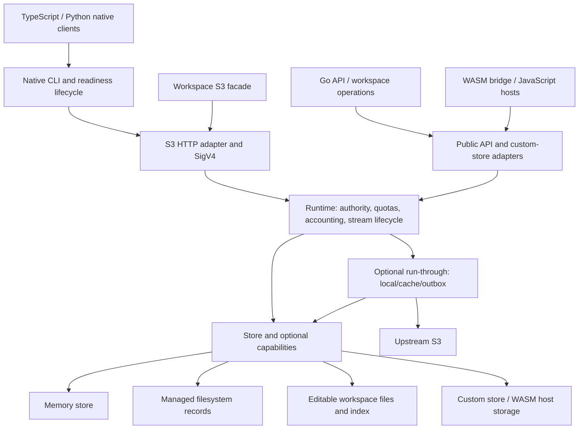

# Stow codebase map and immediate correctness review

Current core correctness status: the [bounded closure register](2026-10-18-correctness-closure.md)
evaluates nine historical leads: no required fix remains, eight leads are
closed, and one is optional strictness. Older follow-ups below are historical;
they do not imply the current queue is empty.

Follow-up: **the confirmed native A1–A3 correctness queue is now corrected**.
The final [filesystem completion change](2026-10-17-filesystem-completion.md) retains
published metadata and accounting after cleanup failure, validated on Railway.
The findings below remain historical evidence; performance follow-up is next.

Follow-up: **workspace DELETE now preserves its committed outcome and partial
batch results**, with [Railway regression evidence](2026-10-17-workspace-delete.md).
Filesystem completion cleanup is the remaining confirmed A3 site.

Reviewed `codex/core-copy-quality` at `7120f18`, against freshly fetched
`origin/main` `219d1dcfff9807b04660a40313b32127e5be2933` (2026-10-15).
This is a structural map plus focused correctness review. Deep dynamic checks
cover publication failures and public-store adaptation; browser persistence,
security and lifecycle components are mapped rather than exhaustively qualified.

**Original findings: two high-priority issues and two medium-priority issues,
all reproduced. The original review included no production changes.**

Follow-up: **F1 is now corrected** in the separate
[multipart publication change](../benchmarks/2026-10-15-multipart-publication/README.md).
The findings and failure logs below describe the original review baseline;
F2–F4 were still open at that point. The original F1 probe passes after that correction.

Follow-up: **F2 is corrected** in the separate
[custom-store COPY change](../benchmarks/2026-10-15-custom-copy-publication/README.md).
It also corrects F3's public-runtime variant, needed to return the committed COPY
result to its caller. F3's two internal adapter variants and F4 were still open
after that correction; the original F4 probe still failed at that point.

Follow-up: **F4 is corrected** in the separate
[custom-store batch deletion change](../benchmarks/2026-10-15-batch-delete-missing/README.md).
The original F4 probe passes after that correction. F3's two internal runtime
COPY adapters were still open at that point.

Follow-up: **F3's remaining internal COPY adapters are corrected** in the separate
[COPY adapter change](../benchmarks/2026-10-15-copy-adapter-publication/README.md).
All six original probes now pass twice normally and twice under the race detector.
F1–F4 were corrected locally at that point. The same report confirmed the buffered
custom-store PUT identity-loss finding, addressed in the next follow-up.

Follow-up: **buffered custom-store PUT now preserves committed identity**, with
[regression and cost evidence](../benchmarks/2026-10-15-buffered-put-publication/README.md).
That report confirms the next separate high-priority finding: the public custom
multipart completion adapter still dropped committed metadata, causing an accounting
panic after publication. It remained unchanged in that PUT correction.

Follow-up: **public custom multipart completion now preserves committed identity
and reconciles confirmed cleanup**, with
[regression and cost evidence](../benchmarks/2026-10-15-custom-multipart-publication/README.md).
The completion panic and removed-upload quota leak are corrected together at the
adapter boundary. Retained or uncertain uploads keep their reservations. That
report also confirmed committed part uploads losing their result and byte
reservation, permitting eight stored bytes under a four-byte cap. Part uploading
remained unchanged in that completion correction; the follow-up below addresses it.

Follow-up: **committed part uploads now preserve their result and byte reservation**,
with [regression and cost evidence](../benchmarks/2026-10-15-part-publication/README.md).
First parts and growing/shrinking replacements are charged on committed errors;
ordinary refusals retain the previous state. The original eight-under-four-byte
probe passes. That report confirmed committed upload initiation bypassing the
session limit: two real uploads could be created at a one-upload cap. Initiation
remained unchanged in that part-upload correction.

Follow-up: **committed initiation now preserves the upload descriptor and reserves
its session/object capacity**, with
[regression and cost evidence](../benchmarks/2026-10-15-initiation-publication/README.md).
Ordinary refusals still reserve nothing, and known committed uploads can be
completed or aborted through the runtime. The original session-cap probe passes.
That report confirmed abort recovery stranding byte, object and session
reservations after a committed abort removed the upload and its parts. Abort
accounting remained unchanged in that initiation correction.

Follow-up: **committed abort now releases byte, object and session reservations**,
with [regression and cost evidence](../benchmarks/2026-10-15-abort-publication/README.md).
The original capacity-reuse probe passes. Ordinary refusals keep reservations;
shared targets retain the surviving uploads' capacity. That report confirmed the
separate S3 issue: custom stores returned 500/InternalError for missing upload IDs
rather than the existing 404/NoSuchUpload contract. Eight route/error-wrapper
combinations reproduced; validation remained unchanged in that abort correction.

Follow-up: **custom-store upload validation now preserves 404/NoSuchUpload**,
with [regression and cost evidence](../benchmarks/2026-10-15-multipart-validation/README.md).
All eight missing-route cases pass; unknown and committed errors retain their
identity. Successful validation remains allocation-free, including large metadata.
That report separately reproduced stale quota reservations after an uncertain
abort is retried and backend absence is confirmed. Direct abort recovery remained
unchanged at that point.

Follow-up: **direct abort recovery now releases reservations on confirmed absence**,
with [regression and cost evidence](../benchmarks/2026-10-15-abort-retry/README.md).
Native raw/wrapped missing errors and public-store missing translation reach the
existing cleanup while preserving the returned error. Concurrent retries clean
up once; uncertainty/refusal and shared targets keep their proper reservations.
That report confirmed a separate S3 variant: route validation rejected the
retry before direct abort recovery could run. HTTP retry reconciliation remained
unchanged in that direct-abort correction.

Follow-up: **S3 validation now reconciles confirmed upload absence**,
with [regression and comparative cost evidence](../benchmarks/2026-10-15-s3-abort-recovery/README.md).
All four multipart routes retain 404/NoSuchUpload while recovering stale quota.
Cached-route matching, independent absence confirmation and target observation
preserve wrong-route, authorization, uncertainty and shared-target guarantees.
Successful validation stays allocation-free; error/recovery costs are measured.
That report separately confirms ambiguous native completion lookup discarding
retained accounting and preventing a repaired policy-scoped abort until explicit
usage refresh. Completion reconciliation remained unchanged at that point.

Follow-up: **completion now retains upload accounting after ambiguous lookup**,
with [regression and comparative cost evidence](../benchmarks/2026-10-15-completion-lookup/README.md).
A missing cause joined with a committed marker cannot discard the retained upload
or hide lookup uncertainty. Repaired policy-scoped direct and S3 aborts recover
without an explicit refresh; ordinary confirmed absence still releases quota.
The report preserves both benchmark passes and their timing variability. It also
confirms a separate object HEAD ambiguity: deletion removes the real object but
leaves phantom usage that blocks capacity reuse. Object-size observation and
deletion remained unchanged at that point.

Follow-up: **ambiguous object HEAD now prevents mutation**, with
[regression and comparative cost evidence](../benchmarks/2026-10-15-object-head-uncertainty/README.md).
The shared size helper and batch-deletion preflight only accept missing without a
committed marker. Actual objects, multipart state and quota remain intact until a
healthy retry; ordinary missing and duplicate batch keys preserve their contracts.
The two guards add no allocations or provider calls; measured classifier and
lifecycle overheads, including adverse samples, are reported. That review also
confirms ReadForSave issuing an absence condition after ambiguous GET while the
backend guard still prevents overwrite. Guarded read classification remained
unchanged at that point.

Follow-up: **ReadForSave now preserves marked missing errors**, with
[regression and comparative cost evidence](../benchmarks/2026-10-15-save-read-uncertainty/README.md).
Uncertain marked GET/body errors issue no usable condition; reliable missing
objects still yield an absence condition and healthy reads retain fingerprinting.
Native and public-wrapper tests preserve retry, quota and stale-save contracts.
The guard adds no allocations or provider calls; all measured timing costs and
variation are retained. That review separately confirms a partial-body failure
without a committed marker being converted into absence after successful open.
The backend still prevents overwrite; body-phase classification remains unchanged
in that marked-read correction.

Follow-up: **ReadForSave now distinguishes opening absence from body failure**,
with [regression and comparative cost evidence](../benchmarks/2026-10-15-save-body-failure/README.md).
Only the opening result can establish absence. Raw/wrapped body errors return no
usable condition, and the existing GET read routine is shared without changing
its buffering/closure contract. New and prior regressions retain healthy, absent,
marked-error, stale-save and access behavior. Ordinary GET and guarded-read timing
and allocation measurements include every adverse sample. A separate probe also
confirms early EOF yielding successful truncated objects and a bound incomplete
condition. Length validation remains unchanged in this body-error correction.

Performance follow-up: [repeated measurements and rejected prototypes](../benchmarks/2026-10-15-save-read-call-boundary/README.md)
retain every adverse result. The original timing concern remains unresolved;
neither private-helper variant demonstrates a dependable overall improvement.
Production source and the shipped WASM are restored exactly to the body-error fix.
No optimization is retained; early EOF remains a separate unimplemented finding.

2026-10-16 follow-up: [measured read-result pointer refinement](../benchmarks/2026-10-16-read-result-pointer/README.md)
removes whole-record copies at the existing private helper boundary. Tiny GET
improves across matched and direct comparisons without extra allocation counts.
Same-code controls and GC counters calibrate large-read variation; adverse +1.7%
/+1.8% direct large-read results remain explicit, with no broad parity claim.
Ownership/error/absence contracts pass; packaged WASM grows 123 bytes. Early EOF
remains the next separate correctness finding.

Follow-up: **buffered GET and guarded reads now reject premature EOF**, with
[regression and comparative cost evidence](../benchmarks/2026-10-16-read-completeness/README.md).
The shared helper compares copied bytes with original metadata size, preserving
real body errors and complete/empty/unknown-size behavior. All 27 new cases pass;
adverse timing samples and the 239-byte WASM growth remain explicit. The report
separately confirms raw streaming APIs still allow early EOF without a read error.
Streaming readers remain unchanged in this buffered-read correction.

Follow-up: **runtime streams now reject premature EOF**, including adapter and
public-wrapper reads, with [regression and comparative cost evidence](../benchmarks/2026-10-16-stream-completeness/README.md).
Expected range length and successful seek positions preserve valid suffix reads.
All 69 new cases pass, including WriterTo; allocation counts remain unchanged
with 16 additional bytes per stream. Adverse direct timings, same-code controls,
and an excluded incomplete-reference measurement are retained. The report confirms
excess provider bytes remain accepted as a separate finding; that path is unchanged.

Follow-up: **runtime reads now reject excess provider bytes**, with
[regression and measurement evidence](../benchmarks/2026-10-16-excess-body/README.md).
Known-length reads consume at most one extra byte to detect overrun and return
only the valid prefix with an error; buffered/guarded results remain empty. All 41
new cases and 990 focused race runs pass. Healthy allocation counts are unchanged;
large adverse wall timings and CPU-time controls are retained without a parity
claim. A separate file-backed probe confirms live readers can be discarded on
opening errors without Close; combined-result ownership remains the next review.

Follow-up: **runtime opening errors now close returned readers**, with
[regression, conformance, race and comparative cost evidence](../benchmarks/2026-10-16-open-error-cleanup/README.md).
Public range fallback preserves reader ownership until the runtime can clean up;
Close failures do not change original errors or guarded absence classification.
The report separately reproduces run-through local/upstream error paths discarding
readers before that cleanup boundary. Run-through remains unchanged in this fix.

Follow-up: **run-through failed reads now release returned readers**, with
[regression, conformance, race and comparative cost evidence](../benchmarks/2026-10-16-runthrough-open-cleanup/README.md).
Local/cache errors close at the adapter boundary; refresh responses also close on
warming HEAD failures, and failed cache readers close before an upstream retry.
Original errors and cache decisions are preserved. The report separately reproduces
native size-limit eviction followed by a changed upstream version returning a new
body with old ETag/metadata. Source-version consistency remains unchanged in this fix.

Follow-up: **refreshed reads now pair bodies with their captured metadata**,
with [deterministic race, durable recovery and cost evidence](../benchmarks/2026-10-16-runthrough-version/README.md).
Cache GET and upstream retry descriptors are retained; changed retry ETags update
the existing provenance before handoff. Stable ETags avoid another save. The
report exposes the changed-version durable fallback's near-2× local timing cost,
and separately confirms refused propagation source reads still leak a returned
reader. Outbox propagation remains unchanged in this correction.

Follow-up: **refused propagation source readers now close before returning their
opening error**, with [regression, race, conformance and comparative cost evidence](../benchmarks/2026-10-16-propagation-open/README.md).
The three-line guard preserves committed state, transient retries and conflict
cleanup. All 33 cases pass; allocations match exactly. Adverse wall timing and
fixed-iteration CPU diagnostics are retained without a parity claim. A separate
probe confirms ambiguous marked-missing HEAD recovery can permanently discard a
prepared write intent despite a real local commit. Prepared recovery remains
unchanged in this reader cleanup correction.

Follow-up: **prepared recovery now preserves marked-missing HEAD uncertainty**,
with [regression, race, conformance and Railway-only cost evidence](../benchmarks/2026-10-16-prepared-recovery/README.md).
Two existing conditions prevent dropping committed write intents and prevent
uncommitted deletes from reaching upstream. All 64 cases pass, including durable
reopen; allocations match. Reliable-missing classification adds 4–7 ns in the
isolated Railway benchmark. The runner is stopped after verified export. All
future performance benchmarks run only on Railway. The report separately proves
mutation preflight can lose the previous version, falsely classify a refused
write as committed and overwrite upstream. Preflight remains unchanged here.

2026-10-16 priority reassessment: the [bounded storage contract audit](2026-10-16-storage-contract-audit.md)
supersedes the rolling "next finding" priorities above. It distinguishes native
filesystem failures from custom-provider defensive cases and consolidates the
remaining work into three ranked defect groups. Native corrupt-upload recovery
is the first recommendation. The marked-missing HEAD preflight repro remains
valid for its injected input, but no native producer was identified; it is not
the leading native correctness finding. No additional implementation is included.

Follow-up: **native filesystem multipart manifest failures now block incomplete quota recovery**,
with [native, runtime and S3 regression evidence](2026-10-16-multipart-recovery.md).
This addresses A1 from the bounded audit. Workspace part/descriptor consistency
(A2) remains the next independent change. No backward-compatibility or migration
path is introduced.

Follow-up: **workspace part descriptors and payloads now publish together**
(A2), with [Railway comparisons and regression evidence](2026-10-16-workspace-parts.md).
The remaining workspace owner-document enumeration can still omit damaged
uploads; that native A1 recovery-class failure is confirmed and left unchanged.

Follow-up: **workspace owner recovery now refuses incomplete accounting**, with
[Railway before/after evidence](2026-10-17-workspace-recovery.md). A3 workspace
DELETE and filesystem completion remain independently queued.

## Codebase map

The facade and native object API share one runtime. The S3 package itself accepts
any internal store; CLI/facade composition supplies the runtime wrapper.

| Area | Entry points | Responsibility and correctness boundary |
|---|---|---|
| Native executable | `cmd/stow-s3/main.go`, `store.go`, `runtime_store.go` | Select local/run-through backing, compose the runtime and HTTP service, report readiness, watch parent lifetime. |
| Go API and workspace orchestration | `pkg/stow/runtime.go`, `workspace.go`, `workspace_facade.go`, `prepare*.go`, `checkpoint*.go`, `handoff*.go`, `resume.go` | Public API, workspace identity, preparation, checkpoints, transfer and retention. Host callers quiesce external file writers. |
| Public adaptation | `internal/embedded/runtime.go`, `store.go`, `streams.go` | Translate public objects/errors and optional custom-store capabilities into internal contracts; shared by native Go and WASM. |
| Runtime | `internal/runtime/instance.go`, `objects.go`, `staged-writes.go`, `streams.go`, `multipart.go`, `usage_*.go`, `state.go` | Admission, authority, quota/reservation ownership and accounting. Staging runs outside the publication lock; publication revalidates under it. |
| S3 protocol | `internal/s3api/server.go`, `copy.go`, `handlers_*.go`; `internal/auth` | Request routing, XML, conditions, ranges, checksums, authentication and request limits. |
| Store contracts and memory | `internal/storage/store.go`, `commit.go`, `staged.go`, `memory*.go` | Shared semantic contracts, optional capabilities, immutable owned payloads and memory multipart state. A committed error denotes a real mutation. |
| Managed filesystem | `internal/storage/fs/fs*.go`, `record_*.go`, `staged_put.go`, `save_*.go`, `recovery_holds.go` | Exclusive directory ownership, atomic versioned records, streamed payloads, save receipts and recovery holds. Raw directory edits are outside the managed public profile. |
| Editable workspace | `internal/storage/workspace/objects.go`, `multipart.go`, `manifest.go`, `resolve.go`, `rooted_reads.go`, `snapshot.go` | Ordinary files plus `.stow` identity/index and multipart data. File publication and index persistence are distinct steps. |
| Upstream and recovery | `internal/runthrough/adapter.go`, `mutations_adapter.go`, `cache_*.go`, `outbox*.go`, `upstream.go` | Local-first mutations, separately bounded cache, explicit upstream-write consent, ordered durable intents and retry/reconciliation. Quota authority excludes separate cache/remote listings. |
| Safety primitives | `internal/authority`, `policy`, `policystore`, `capacity`, `rooted`, `atomicfile` | Grants and policy revisions, namespace admission, confined filesystem access and durable publication primitives. |
| WASM | `cmd/stow-wasm/main.go`, `operations.go`, `binary_js.go`, `host_store*.go` | Runtime handles, JSON/binary protocol and host callbacks. Its dependency closure uses embedded/runtime contracts without native server code. |
| TypeScript native clients | `packages/stow-s3/src/session.ts`, `start.ts`, `ready*.ts`, `workspace*.ts` | Native process ownership, isolated session configuration, readiness parsing, CLI/workspace lifecycle and SDK integration. |
| Browser persistence | `packages/stow-s3/src/embedded.ts`, `async-embedded.ts`, `worker-host.ts`, `content-*.ts`, `project*.ts`, `file-history*.ts`, `persistent-embedded.ts`, `indexeddb-*.ts` | WASM hosts, persistence ownership, content staging/GC, project revisions and file history. Snapshot replay and host-backed streaming are separate shipped profiles. |
| Python client | `packages/stow-s3-py/src/stow_s3/{session,ready,workspace,workspace_serve,bin}.py` | Native process/workspace wrappers; S3 I/O is delegated to the caller's client. |
| MCP | `internal/mcpstorage` and native CLI wiring | Tool-facing object/workspace operations and browser UI; relies on the underlying admission and authorization layers. |
| Verification | `conformance`, backend contract tests, runtime/adapter tests, TS/Python tests, `scripts` | Four core conformance profiles, shared workspace/corpus cases, race checks, generated artifacts and quality gates. |

Planned notification and expanded ACL/encryption ADRs are outside this shipped map.

## Baseline reconciliation

Completed work excluded from the findings:

- Main already has date-only COPY condition forwarding and streamed filesystem
  metadata-replacement COPY (PR 71).
- This branch retains the run-through condition fix, restored backend COPY costs,
  combined byte/object reopen quota fixes and clean-checkout documentation checker.
- The separate `codex/patch-0.3.2` branch already contains stream cleanup,
  workspace host-edit/snapshot identity fixes, multipart capacity publication and
  bounded preparation/checkpoint work. Those are not presented as new findings.
- The old lead that `policystore.Policy(env)` ignores its authority is stale:
  current code calls `policy.New(set, env)`.

Every implicated production file below is byte-identical between this branch
and `origin/main`. Reproductions used this branch, with its repaired quota checks.
The sibling patch branch does not repair these error-result paths; its workspace
multipart change adds host-edit identity bookkeeping after the failing branch.

## Immediate findings

### F1 — High: workspace multipart completion panics after publishing content

Location: [workspace completion](../../internal/storage/workspace/multipart.go#L234),
then [runtime accounting](../../internal/runtime/usage_state.go#L58).

Trigger: create/upload a real workspace multipart part, then obstruct
`.stow/index.json` with a directory immediately before completion. This models a
real index-persistence failure, using the same failure pattern as the existing
workspace PUT test.

`putLocked` publishes the destination and returns its metadata together with
`ErrMutationCommitted`. `CompleteMultipartUpload` drops that metadata at line 236,
returning `nil` with the committed error. Runtime accounting recognizes the
committed marker, then dereferences `meta.Size` and panics.

Observed twice normally and twice under `-race`: `target` contains `body`, but
the call panics and committed usage remains `{Bytes:0 Objects:0}`. No data race
is needed. Through a standard Go HTTP server, an uncaught handler panic aborts
that request; this is not a claim that net/http crashes the whole server.

First fix priority. Preserve the publication outcome and object identity while
keeping multipart ETag, retained upload parts and quota reservations consistent.
A nil guard alone does not establish correct accounting. Releasing reservations
for upload files still retained on disk would introduce another quota defect.

### F2 — High: custom-store fallback COPY panics on a committed error

Location: [public-store COPY fallback](../../internal/embedded/store.go#L298),
then [runtime accounting](../../internal/runtime/usage_state.go#L58).

A supported caller-supplied base `Store` writes successfully and returns the
object plus the exported committed-error marker for a later failure. Without
optional `CopyStore`, the existing adapter expresses COPY through GET and PUT.
The PUT result is discarded on any error, including a committed one, producing
`nil` metadata for the runtime's committed accounting.

Observed twice normally and twice under `-race`: the destination contains `body`,
the call panics, and outer usage remains at the source only: four bytes/one
object instead of eight bytes/two objects. The reproduction uses the public
`Open(Options{Store: ...})` seam with a custom store that explicitly reports the
committed outcome; it requires no external writer or unsupported race.

Correct the result/error adaptation. Keep the existing base-store capability and
COPY behavior; no generic snapshot emulation or new storage abstraction is needed.
The neighboring buffered PUT and multipart adapters also discard metadata on
errors and deserve contract coverage within their own supported operations.

### F3 — Medium: COPY wrappers discard an already-committed object's identity

Locations: [runtime adapters](../../internal/runtime/adapter.go#L142), including
conditional COPY at line 155, and [public runtime](../../internal/embedded/runtime.go#L127).

Using the same real workspace index obstruction, direct runtime COPY knows the
published destination metadata and accounts for it. Its wrappers return nil or
an empty object on every error, including `ErrMutationCommitted`.

All three wrapper variants reproduce twice normally and twice under `-race`:
the destination contains `body`, usage correctly reports eight bytes/two objects,
and the committed marker survives, but returned key and ETag are empty. This is
loss of the known committed identity, not demonstrated loss of stored bytes or
incorrect accounting on these three paths. Callers lose the precise version
result needed to assess the failed operation without another mutable HEAD.
PUT already preserves this class of committed result.

### F4 — Medium: a custom store's missing key stops batch deletion

Location: [public-store batch adaptation](../../internal/embedded/store.go#L278).

A custom store correctly returns public `ErrObjectNotFound` from `DeleteObject`.
The batch wrapper checks it against the distinct internal sentinel before
translation, treats it as a failure and stops the batch.

Observed twice normally and twice under `-race`: deleting `[missing, existing]`
returns an empty deleted list and an object-not-found error; `existing` remains.
This violates the internal `Store.DeleteObjects` contract and the documented S3
idempotent-delete behavior. The old remediation plan listed this as an open lead;
this review confirms it rather than repeating completed work.

Normalize the sentinel before deciding whether deletion failed. Preserve real
partial failures and their confirmed-deleted prefix.

## Evidence, tooling and review limits

[Metadata](2026-10-15-codebase-map/metadata.json) records the baseline and tools.
Go vet across the repository, TypeScript source/test type-checks, ESLint, Python
syntax checks for all six source files, Go quality and file-size gates pass.
The existing runtime, embedded, workspace and S3 tests pass after probes are
removed: [ordinary suite output](2026-10-15-codebase-map/existing-tests.log).
Fresh conformance and broad race results for the immediately preceding storage
fix are in the [object-quota report](../benchmarks/2026-10-15-reopen-object-quota/README.md).

Six probe cases were each run twice normally and twice under the race detector.
They fail deterministically for the behaviors above; no data races were reported.
Sources and actual output are retained:

- [Native workspace/runtime probes](2026-10-15-codebase-map/runtime_probe.go.txt),
  [normal output](2026-10-15-codebase-map/runtime-probe.log),
  [race output](2026-10-15-codebase-map/runtime-probe-race.log).
- [Custom-store probes](2026-10-15-codebase-map/embedded_probe.go.txt),
  [normal output](2026-10-15-codebase-map/embedded-probe.log),
  [race output](2026-10-15-codebase-map/embedded-probe-race.log).

To reproduce, temporarily copy each `.go.txt` into its corresponding
`internal/runtime` or `internal/embedded` directory as `map_review_probe_test.go`,
then run `go test ./internal/runtime ./internal/embedded -run '^TestMap' -count=2`
(or add `-race`). Remove those temporary files afterward: they deliberately fail
until the fixes are implemented. They are stored as text so this report does not
break the normal suite. Failure fixtures restore the obstructed index before
closing the workspace.

No implementation fix, new dependency, storage format or public API is included.
No optimization or architecture rewrite is proposed. Fix F1 first, then F2, with
separate regression-tested changes that preserve publication and recovery costs.
